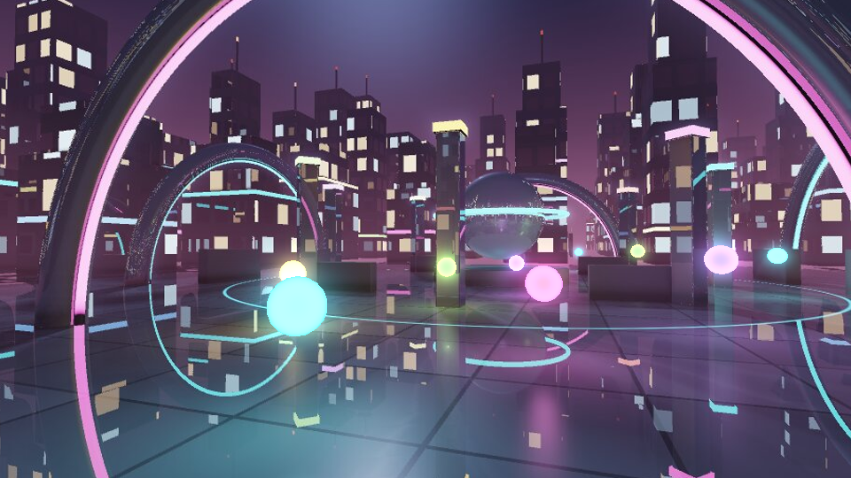
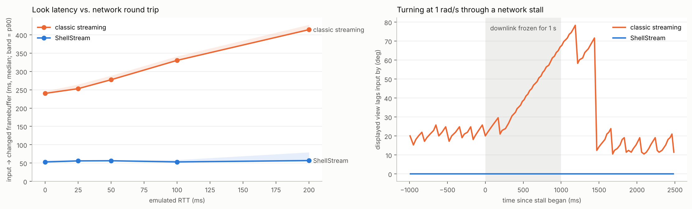
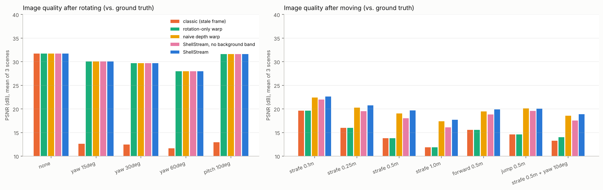
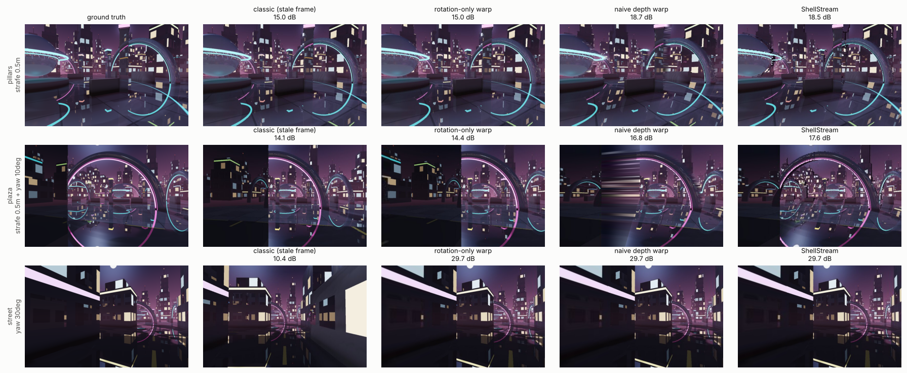
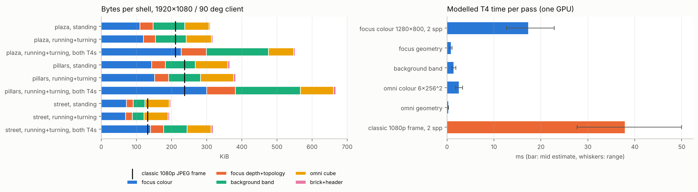
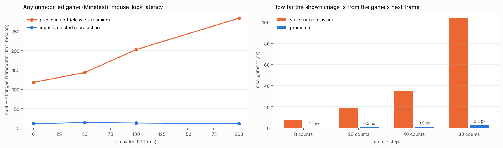

# ShellStream: Latency-Inverted Cloud Rendering on Kaggle T4 x2

*Technical report for the ShellStream proof of concept. The notebook is [`ShellStream.ipynb`](ShellStream.ipynb); the sources are in [`shellstream/`](shellstream/).*



*The real browser client showing a cloud-rendered shell (CPU build of the T4 kernel in this run). The
glowing orbs are game objects owned and drawn by the browser; the coloured light they cast on the wet
floor is rendered by the server from the light list the client sends.*

---

## Summary

Classic cloud gaming streams **frames**. Every input (a mouse flick, a step) has to travel to the
data centre, be simulated, rendered, encoded, sent back, decoded and displayed before the player sees
it. Responsiveness is therefore bounded below by the network round trip, and no amount of GPU
power changes that.

ShellStream removes the round trip from the interaction path. The cloud GPUs don't render the player's
frame. They render a **shell**: a set of views around the player's predicted position that carries
colour, exact 16-bit inverse depth, and a per-texel **topology map** marking real occlusion edges. Each
shell has a high-resolution, adaptively widened focus layer, a **background band** that holds the
surfaces hidden behind occluders (traced only where predicted motion can reveal them), a 360-degree
fallback cube, and a small signed-distance **collision brick**. The browser owns the camera, the game
logic and the final image. At every display refresh it re-projects the newest shell from the camera
pose sampled at that instant, using a mesh that tears exactly at the server-marked occlusion edges and
only once motion has actually opened a gap.

**Pass 2** extends this in two directions. **Any game:** a game host streams *unmodified* games (tested
with the open-source game Minetest). It injects your input, encodes with NVENC, and learns online how the
image moves per mouse count and which pixels are HUD. The browser then predicts mouse-look locally for a
game it knows nothing about (section 11, which also covers Roblox). **Both T4s fully:** each T4 now renders
a complete shell from its own viewpoint, the browser composites them, and GPU stages overlap host stages,
with a load governor, idle refinement and NVENC (section 12). **Pass 3** makes Roblox playable online:
the official client on a Windows machine with two T4s, with full desktop control, game audio, 60 fps, HTTPS
and an access token, set up by one script (section 13).

Looking, moving, jumping and picking things up therefore have the *latency* of a local PC: about one
display frame. Network RTT, jitter and even multi-second stalls only affect how *fresh* the lighting
and distant content are. Human perception tolerates that far better than lag between hand and eye. *Image
quality* is a separate question: rotations reproduce a local render, but translations still fall well
short of one (section 4.4).

**Key results (development run; see the report for method and caveats)**

| | ShellStream | classic cloud streaming |
|---|---|---|
| look latency, input to finished frame, RTT 0 to 200 ms | **53-57 ms, flat** (= one frame of the software-rendered test client; one display refresh on a real GPU) | 240 -> 414 ms, grows with RTT |
| view lag while turning through a 1 s network stall | **0.0 deg** | up to 67 deg |
| image after a 30-degree turn (PSNR vs. 16-spp truth) | **29.0 dB** (local 1-spp render: 29.7) | 12.5 dB (stale frame) |
| image after a 0.5 m strafe | **25.7 dB** with both T4s (19.7 with one shell; naive depth warp 19.1) | 13.8 dB |
| inside regions newly revealed by a 0.5 m strafe | **22.5 dB** both T4s (16.0 one shell; naive 12.8, no band 9.8) | 10.7 dB |
| **any unmodified game** (Minetest via the game host): mouse-look latency, RTT 0 to 200 ms | **11-14 ms** with input-predicted reprojection (lower than the row above only because this client draws a single textured quad, which software rendering finishes sooner) | 118-284 ms |
| T4 time per update (modelled; measured by the notebook) | 11.2 ms on 2 T4s (22.3 on one) | 37.9 ms per 1080p frame on one T4 |
| bytes per update, 1080p client | 367 KiB (JPEG; about 4x less colour with NVENC-class video) | 193 KiB |

Under translation the gap to a local render is still large. Wet-floor mirror reflections explain much
of it for small moves (a reflection ablation is in the report); the rest is open. For closed games, only
mouse-look is predicted; movement and actions still take the round trip. T4 timings are modelled here and
measured by the notebook.

---

## 1. First principles: where cloud-gaming latency comes from, and what can actually move

A classic cloud-gaming input travels this chain (typical ranges for a good consumer connection):

| Stage | Typical time |
|---|---|
| input sampled, sent with the next packet | 1-8 ms |
| uplink, one way | 10-50 ms |
| server simulation and render | 8-16 ms |
| hardware encode | 3-10 ms |
| downlink one way + serialisation of the frame | 10-60 ms |
| browser decode | 2-10 ms |
| display: wait for vsync + scan-out | 8-25 ms |
| **input to photon** | **~50-150 ms** |

A local gaming PC sits at roughly 20-40 ms for the same chain without the network. The difference is
dominated by the **round trip**, which is bounded by the speed of light in fibre (about 1 ms of RTT per
100 km in practice) and by the routing between the player and the data centre. A faster GPU removes
none of it.

So the useful question isn't "how do we make the pipeline faster?" but **"which parts of what the
player sees actually need the network on the critical path?"** Splitting a game's output by how
latency-sensitive it is and how expensive it is to compute gives:

| Information | Changes within one RTT | Latency sensitivity | Compute cost | Where it belongs |
|---|---|---|---|---|
| camera orientation (mouse look) | a lot | extreme: the hand-eye loop | trivial (a matrix) | **client** |
| camera position (movement, jumps) | moderately | high | trivial, but needs collision | **client** (with streamed collision data) |
| own actions, local effects, HUD | instantly | high | cheap | **client** |
| world appearance: shading, lighting, reflections, detail | slowly | low (lag is perceived as "lighting delay", not input lag) | **very expensive** | **cloud GPUs** |
| other dynamic objects | depends | medium | cheap to draw, expensive to light | geometry on the client, **light from the cloud** |

The conclusion is a design principle, which I'll call **latency inversion**: *put the network round
trip on the paths that change slowly and cost a lot, and take it off every path a human closes a loop
through.* The server must then produce something that stays valid while the client's camera keeps moving
for one RTT or more. That means a *representation* with depth, coverage beyond the current frustum, and
knowledge of what is hidden, rather than a frame.

---

## 2. Architecture

```
  Kaggle T4 #0 ────────────┐                        Browser (any WebGL2 GPU)
    focus colour, top half │                         every display refresh (60-240 Hz):
                           │   ┌─────────────────┐     1. sample mouse/keys (late-latched)
  Kaggle T4 #1 ────────────┼──▶│  shell message  │─WS─▶ 2. step physics vs. streamed SDF brick
    focus colour, bottom   │   │ JPEG colour     │     3. re-project newest shell with *current* camera:
    focus geometry + topo  │   │ 16-bit inv. z   │        omni cube -> background band -> focus layer
    background band (LDI)  │   │ topology bits   │     4. draw local objects (orbs) with depth test
    omni cube, 6 faces     │   │ SDF brick       │     5. send pose, velocity, angular rate, light list
    collision brick ───────┘   └─────────────────┘                     │
                    ▲ predicted pose, guard band, light list ◀─────────┘
```

### 2.1 The shell

| Layer | Content | Default size (1080p client) |
|---|---|---|
| focus colour | perspective view centred on the *predicted* view direction, field of view widened by an adaptive guard band, 2 samples/pixel rotated-grid AA, JPEG | 1.0 MP budget |
| focus geometry | 16-bit inverse view-z per 2x2 block + 3 topology bits | 1/4 of the colour |
| background band | second surface (what's behind the occluder) for texels within the predicted disocclusion distance of an edge; first surface for background texels next to edges; nothing elsewhere | 1/4 of the colour, mostly empty |
| omni cube | 6 x 256^2 colour + geometry + topology at the same centre | fallback for any direction |
| collision brick | 48 x 18 x 48 signed distances at 0.25 m, int8 centimetres | 12 x 4.5 x 12 m around the player |

### 2.2 Server: planning a shell

Given the client's last reported state (position, velocity, yaw/pitch, angular rates, field of view,
display size, measured RTT), the server:

1. **Predicts** the pose at the middle of the shell's useful life: look-ahead
   `L = RTT/2 + pipeline + 0.5 x shell interval`, position `p + v L`, orientation extrapolated with 80 %
   of the angular rate.
2. **Sizes the guard band**: `margin = 7 deg + |extrapolated rotation| + 0.5 x |angular rate| x L`.
   Field of view = client FOV + 2 x margin, inside a **fixed pixel budget**. Standing still, pixels
   concentrate in the view; during a fast turn the band widens and angular resolution drops. That's
   when motion blur and saccadic suppression hide it (*resolution follows stability*).
3. **Sizes the disocclusion band** `delta = 0.5 m + 0.6 x speed x L`, the unpredicted translation the
   shell must survive (direction changes, jumps).
4. **Schedules the work on both T4s** (section 2.6) and encodes.

### 2.3 Exact topology: telling the client where the world really tears

A depth map alone can't say whether two neighbouring texels lie on the same surface. A floor seen at a
grazing angle jumps in depth between rows just like a real occlusion edge, while a box corner (a crease)
has continuous depth but a discontinuous normal. Client-side heuristics get one of the two wrong. The
server *knows* the geometry, so the GPU computes, for every texel and its right, lower and anti-diagonal
neighbours, whether they belong to one surface:

```
connected(a, b) =  |p_b - p_a| < 2.5 x pixel footprint                    (creases, tiny steps)
                or max(|n_a . (p_b - p_a)|, |n_b . (p_b - p_a)|) < 0.2 |p_b - p_a|   (same local plane)
```

`p` are exact hit positions and `n` exact SDF normals. Requiring *both* normals to agree rejects
silhouettes, where the occluder's normal is perpendicular to the view ray and would otherwise pass. Three
bits per texel compress to a few kilobytes with deflate.

### 2.4 Client: re-projection with motion-adaptive tearing

Each layer is drawn as an attribute-less triangle grid (`gl_VertexID` -> texel). The vertex shader fetches
inverse depth and topology, un-projects with the shell's camera and re-projects with the current camera.
Sky texels become points at infinity (`w = 0`), so rotation is exact for any field of view, with an
infinite-far projection.

A triangle whose three edges are all connected is drawn normally. A **torn** triangle (it spans an
occlusion edge) is handled by comparing its on-screen size under the full warp with its size under a
rotation-only warp:

* within 1.5 px: no gap has opened yet, so draw it as is. Edges stay exact when the camera hasn't moved.
* larger: in the focus and background layers, drop it, so whatever lies behind shows through. In the
  omni fallback, flatten it to the depth and colour of its *farthest* corner, so remaining holes are
  filled with background rather than smeared occluder.

Three details turned out to matter as much as the geometry (section 5 has the measurements):

* **Source-affine texture mapping.** GPUs interpolate varyings perspective-correctly *in the target
  view*, but a shell's texels form a regular grid *in the source view*. The shader interpolates
  `(uv x z_src, z_src)` and divides per fragment. That is the exact source-affine mapping for any camera
  motion, and the identity when the camera hasn't moved.
* **Layer priority: stencil where it must, depth where it should.** The sharp focus layer marks the
  stencil, and the coarse omni fallback can never override it: its coarse silhouettes are sometimes
  legitimately *nearer*, so depth alone let them leak. Inside the focus layer's holes, the background
  band and the fallback compete by depth: the band knows what is *behind* an edge, but the fallback may
  hold a nearer surface, such as a wall right next to the camera.
* **Bicubic (Catmull-Rom) reconstruction** with 9 bilinear taps, since every re-projected texel lands
  between display pixels.

Draw order: focus layer (stencil-marking), background band and omni fallback (stencil-restricted,
depth-tested against each other, omni pushed 3 % back), then local dynamic objects (depth-tested against
everything). Input is **late-latched**: mouse deltas
are applied at the start of the `requestAnimationFrame` callback that renders, and the canvas is created
`desynchronized`.

### 2.5 Client-authoritative play

* **Movement and collision** run in the browser at 240 Hz sub-steps against the streamed SDF brick
  (trilinear distance, gradient push-out, ground detection). The server never sees the player "wait".
* **Dynamic objects** (glowing orbs to collect) are owned and drawn by the client, depth-tested against
  the re-projected world. Their **light** is sent to the server and rendered into the world's shading:
  a *latency-tolerant channel*. Geometry is on the latency-critical path and is local; light reaching the
  floor 50 ms late is imperceptible.

### 2.6 Using two T4s

* **Layer parallelism:** T4 #1 owns geometry, topology, the background band, the omni cube and the brick.
* **Split-frame focus rendering:** the focus colour is split into two row stripes, one per GPU, each
  encoded by that GPU's nvJPEG and uploaded by the client into one texture with `texSubImage2D`. The split
  row is re-balanced every frame from the measured per-GPU times, so both GPUs finish together and the
  shell's latency is the *maximum* of two halves rather than the sum.

### 2.7 Transport

* One WebSocket carries everything: input and acks up, shells down. It runs through Tornado, which ships
  with every Jupyter installation, so Kaggle needs no extra dependency.
* **Ack-based flow control**: at most two un-acknowledged shells are in flight, so TCP buffers never fill
  and a congested link costs freshness, not queueing delay.
* **Event-driven:** a shell is rendered only when the pose or the light list changes (or on a timer
  when content animates). A player standing still costs about zero GPU and bandwidth.
* **Decoupled rates:** the display rate (the client's refresh) is independent of the shell rate (30-45/s
  by default). Shells are decoded in a Web Worker (`createImageBitmap`, `DecompressionStream`) and
  double-buffered, so decoding never stalls the render loop.

### 2.8 Lossless geometry coding (a hypothesis that measurement rejected)

Inverse view-z `u = z_near / z` is *affine in screen space* on any plane, so my first codec used a
second-order horizontal predictor `u[x] - 2u[x-1] + u[x-2]`, which is exactly zero on planes. Measured on
real buffers, it **lost**: 16-bit rounding turns second differences into ±1-2 noise, and most texels are
distant surfaces whose first differences are already near zero. `bench/codec_explore.py` compared four
predictors x two byte layouts x three deflate levels. The JPEG-LS **median edge detector (MED)** with
zig-zag residuals in low/high byte planes and deflate level 6 won, beating PNG-16 too (section 4.5). The
browser decodes it in a 15-line loop inside the decode worker; the Python and JS decoders are
bit-exact against the encoder.

### 2.9 One kernel, two targets

`kernel.cu` is plain C++ with a tiny vector library and two macros. NVRTC (via CuPy) compiles it for
the T4s; `g++ -fopenmp` compiles the same file for any CPU. The CPU build is the fallback (the notebook
runs without a GPU), the **ground-truth oracle** for the quality experiments, and the **instrumented
build** for the T4 cost model. ptxas for sm_75: `ss_render` uses 107 registers with **no spills and no
stack** (verified in this report's toolchain run).

---

## 4. Experiments and results

### 4.1 Setup, and what was and wasn't measured

The development container has **no GPU**, 4 CPU cores and no access to Kaggle. Everything below was
therefore run with:

* **Server:** the CPU build of the *same* `kernel.cu`, driven by the same `engine.py` / `server.py` that
  run on the T4s.
* **Client:** the real browser client in headless Chromium. WebGL2 runs on SwiftShader, a software GPU
  sharing the 4 CPU cores with the server.
* **Network:** emulated inside the server (one-way delays, jitter, a downlink stall switch). Everything
  else is a real WebSocket on localhost.

Image quality, bytes, codec results and the ptxas report are hardware-independent. Latency *shapes* are
hardware-independent; absolute latencies are inflated by the software client (about 57 ms per frame instead
of 7-17 ms on a real GPU) and, for classic mode, by the slow CPU server. **T4 timings are modelled, not
measured**; the notebook measures them on Kaggle.

### 4.2 Look latency vs. network round trip

A 7-degree mouse-look step is injected; latency runs until the GPU has finished the first frame whose
pixels reflect it (one-row `readPixels` after every frame). 12 trials per point.



| emulated RTT | ShellStream: input -> frame (median / p90) | classic: input -> frame (median / p90) | classic server build (CPU) | client frame interval (shell / classic) |
|---|---|---|---|---|
| 0 ms | **53** / 58 ms | 240 / 246 ms | 134 ms | 56 / 29 ms |
| 25 ms | **56** / 58 ms | 253 / 265 ms | 109 ms | 57 / 28 ms |
| 50 ms | **56** / 58 ms | 278 / 289 ms | 98 ms | 59 / 29 ms |
| 100 ms | **53** / 58 ms | 330 / 341 ms | 95 ms | 57 / 28 ms |
| 200 ms | **57** / 79 ms | 414 / 428 ms | 98 ms | 59 / 27 ms |

**ShellStream's look latency is flat: one client frame at every RTT from 0 to 200 ms.** Classic streaming
grows with RTT (slope ≈ 0.90 ms per ms of RTT) on top of server time, decode and frame waits. With a real GPU client
the ShellStream number becomes one display refresh (16.7 ms at 60 Hz, 6.9 ms at 144 Hz). That is the
same as a game running locally, which also needs one frame to show an input.

### 4.3 Through a network stall

The camera turns continuously at 1 rad/s; the downlink is frozen for 1 s.

| | view lag while turning, before the stall (median) | max view lag during the 1 s stall | client frames rendered during the stall | max frame interval |
|---|---|---|---|---|
| ShellStream | 0.0 deg | 0.0 deg | 19 | 88 ms |
| classic | 21.0 deg | 66.8 deg | 38 | 52 ms |

The ShellStream view follows the mouse exactly, before, during and after the stall: the client keeps
re-projecting the last shell, and only freshness of lighting suffers. Classic streaming already trails the
input by about 21 degrees while turning (its round trip at 1 rad/s), and the stall adds a full second of
frozen view.

### 4.4 Image quality under motion

A shell is rendered at pose P0 and frozen. The client then renders from displaced poses, and each image
is compared with a **16-sample anti-aliased ground truth** at exactly that pose. Three scenes (plaza,
pillars, street); 640x400 client, 90-degree FOV; server at 2 spp, budget 0.6 MP. "Local PC" columns show
what a local machine running the same renderer would display, the ceiling for any streaming method.



**PSNR (dB), mean of 3 scenes** (best streaming method in bold):

| displacement | local PC, 1 spp | local PC, 2 spp | classic (stale frame) | rotation-only warp | naive depth warp | ShellStream w/o band | ShellStream, 1 shell | **ShellStream, both T4s** |
|---|---|---|---|---|---|---|---|---|
| none | 29.00 | 33.29 | **31.61** | **31.61** | 30.99 | 30.99 | 30.99 | 30.99 |
| yaw 15deg | 29.29 | 33.52 | 12.64 | **29.94** | 29.28 | 29.27 | 29.27 | 29.27 |
| yaw 30deg | 29.70 | 34.01 | 12.46 | **29.61** | 28.99 | 28.99 | 28.99 | 28.99 |
| yaw 60deg | 31.77 | 35.89 | 11.65 | **27.96** | 26.69 | 26.68 | 26.68 | 26.68 |
| pitch 10deg | 29.21 | 33.55 | 12.92 | **31.49** | 30.88 | 30.87 | 30.87 | 30.87 |
| strafe 0.1m | 29.01 | 33.18 | 19.72 | 19.72 | 22.52 | 22.04 | **22.71** | **22.71** |
| strafe 0.25m | 28.89 | 33.19 | 16.00 | 16.00 | 20.34 | 19.52 | 20.78 | **21.26** |
| strafe 0.5m | 28.58 | 32.93 | 13.79 | 13.79 | 19.08 | 18.03 | 19.70 | **25.68** |
| strafe 1.0m | 28.48 | 32.77 | 11.87 | 11.87 | 17.25 | 16.13 | 17.72 | **18.76** |
| forward 0.5m | 29.17 | 33.01 | 15.56 | 15.56 | 19.49 | 18.86 | **19.92** | **19.92** |
| jump 0.5m | 29.12 | 33.23 | 14.62 | 14.62 | **20.12** | 19.55 | 20.02 | 20.02 |
| strafe 0.5m + yaw 10deg | 29.05 | 33.04 | 13.26 | 14.03 | 18.56 | 17.58 | 18.90 | **24.33** |

<details><summary>SSIM</summary>

| displacement | local PC, 1 spp | local PC, 2 spp | classic (stale frame) | rotation-only warp | naive depth warp | ShellStream w/o band | ShellStream, 1 shell | **ShellStream, both T4s** |
|---|---|---|---|---|---|---|---|---|
| none | 0.954 | 0.975 | **0.945** | **0.945** | 0.941 | 0.941 | 0.941 | 0.941 |
| yaw 15deg | 0.955 | 0.977 | 0.483 | **0.933** | 0.927 | 0.927 | 0.927 | 0.927 |
| yaw 30deg | 0.958 | 0.978 | 0.471 | **0.930** | 0.925 | 0.925 | 0.925 | 0.925 |
| yaw 60deg | 0.969 | 0.983 | 0.449 | **0.915** | 0.908 | 0.908 | 0.908 | 0.908 |
| pitch 10deg | 0.956 | 0.977 | 0.488 | **0.946** | 0.942 | 0.942 | 0.942 | 0.942 |
| strafe 0.1m | 0.953 | 0.974 | 0.799 | 0.799 | 0.837 | 0.831 | **0.840** | **0.840** |
| strafe 0.25m | 0.952 | 0.975 | 0.672 | 0.672 | 0.787 | 0.771 | 0.793 | **0.818** |
| strafe 0.5m | 0.948 | 0.972 | 0.576 | 0.576 | 0.741 | 0.717 | 0.751 | **0.886** |
| strafe 1.0m | 0.948 | 0.972 | 0.483 | 0.483 | 0.688 | 0.661 | 0.697 | **0.741** |
| forward 0.5m | 0.952 | 0.974 | 0.676 | 0.676 | 0.771 | 0.759 | **0.780** | **0.780** |
| jump 0.5m | 0.954 | 0.976 | 0.624 | 0.624 | **0.779** | 0.758 | 0.769 | 0.769 |
| strafe 0.5m + yaw 10deg | 0.953 | 0.974 | 0.505 | 0.591 | 0.741 | 0.716 | 0.748 | **0.877** |

</details>



Reading the table:

* **Rotation is solved.** Within the guard band (up to 30 degrees here), ShellStream stays within
  2.0 dB of its zero-motion value and matches a local 1-spp render (30 degrees: 29.0 dB vs. 29.7 dB for a local 1-spp render). At 60
  degrees part of the view comes from the coarser omni cube until the next shell arrives
  (26.7 dB): softer, but never a hole. The classic stale frame collapses to 12-13 dB because it shows
  the wrong view until the next frame arrives.
* **Translation is where the layers earn their keep.** For a 0.5 m strafe (about 90 ms of sprinting),
  a single shell reaches 19.7 dB and both T4s together 25.7 dB, vs. 13.8 dB for the classic stale
  frame and 19.1 dB for a naive depth warp. Removing the background band from a single shell costs
  1.7 dB. Section 12 covers the two-T4 columns, including a fairness note.
* **At rest it is exact.** With source-affine texture mapping, every method reproduces the server frame
  bit-for-bit at zero motion. The remaining 2.3 dB to a local 2-spp render is JPEG plus bicubic
  resampling.

**Where the layers matter: inside disocclusions.** Whole-frame PSNR is dominated by errors every method
shares. `bench/disocc.py` finds the pixels whose surface was *hidden* from the shell's viewpoint
(ground-truth geometry, shadow-map test against a wide depth map at P0) and scores only those:

| scene, displacement | pixels newly revealed | classic (stale frame) | rotation-only warp | naive depth warp | ShellStream w/o band | ShellStream, 1 shell | **ShellStream, both T4s** |
|---|---|---|---|---|---|---|---|
| plaza, strafe 0.5m | 20.1 % | 11.00 | 11.00 | 12.74 | 10.53 | 15.53 | **21.29** |
| plaza, strafe 0.5m + yaw 10deg | 17.4 % | 11.60 | 11.01 | 12.80 | 10.56 | 15.31 | **20.86** |
| pillars, strafe 0.5m | 3.6 % | 11.69 | 11.69 | 12.92 | 9.92 | 13.85 | **24.27** |
| pillars, strafe 0.5m + yaw 10deg | 3.3 % | 11.15 | 11.52 | 12.58 | 9.62 | 13.64 | **22.99** |
| street, strafe 0.5m | 1.4 % | 8.58 | 8.58 | 13.02 | 9.14 | 18.92 | **22.82** |
| street, strafe 0.5m + yaw 10deg | 1.1 % | 10.00 | 8.72 | 12.94 | 9.08 | 18.47 | **22.68** |
| **mean** | | 10.67 | 10.42 | 12.83 | 9.81 | 15.95 | **22.48** |

Inside newly revealed regions, the background band is decisive. It shows the actual hidden surface
instead of a smear (naive warp), a stale frame, or a background-coloured fill (no band).

**Why the translation gap to "local" is still large: view-dependent shading.** This city is wet and neon:
much of every frame is mirror reflection, which depth re-projection moves with the *surface* instead of
with the *mirror image*. Turning reflections off in both the server and the reference isolates the effect:

| displacement | one shell, scene with reflections | gap to local 2 spp | one shell, reflections off | gap to local 2 spp |
|---|---|---|---|---|
| none | 29.88 dB | 2.71 dB | 33.62 dB | 1.96 dB |
| yaw 30deg | 28.59 dB | 5.13 dB | 33.56 dB | 4.31 dB |
| strafe 0.1m | 21.31 dB | 11.17 dB | 29.05 dB | 6.28 dB |
| strafe 0.5m | 18.30 dB | 13.61 dB | 22.52 dB | 12.27 dB |
| forward 0.5m | 18.56 dB | 13.73 dB | 24.82 dB | 10.45 dB |

Mirror reflections explain most of the gap for *small* displacements (4.9 dB of 11.2 dB at a
0.1 m strafe) and a smaller share for larger ones (1.3 dB at 0.5 m, 3.3 dB for 0.5 m
forward). They are the target of the designed virtual-depth reflection layer (section 10). The residual
that remains with reflections off is **not explained by these experiments**. Likely contributors, all
untested: the other view-dependent terms the ablation keeps (volumetric neon glow, specular
highlights), disocclusions wider than the band, and PSNR's sensitivity to sub-pixel misregistration of
high-contrast window textures.

### 4.5 Bandwidth and coding

Per-layer bytes for a 1920x1080 / 90-degree client (focus budget 1.0 MP, 2 spp, JPEG q85 colour):



| scene, motion | focus | focus colour | focus depth + topology | background band | omni cube | brick + header | **total** | classic 1080p JPEG |
|---|---|---|---|---|---|---|---|---|
| plaza, standing | 1344x752 | 110 | 38 | 90 | 69 | 4 | **310** | 211 |
| plaza, running+turning | 1488x672 | 120 | 34 | 88 | 72 | 4 | **317** | 211 |
| plaza, running+turning, both T4s | 1488x672 | 227 | 72 | 176 | 72 | 5 | **552** | 211 |
| pillars, standing | 1344x752 | 144 | 39 | 84 | 93 | 6 | **366** | 237 |
| pillars, running+turning | 1488x672 | 151 | 40 | 91 | 94 | 6 | **383** | 237 |
| pillars, running+turning, both T4s | 1488x672 | 300 | 81 | 185 | 94 | 7 | **668** | 237 |
| street, standing | 1344x752 | 72 | 19 | 34 | 69 | 4 | **198** | 132 |
| street, running+turning | 1488x672 | 69 | 19 | 33 | 68 | 4 | **194** | 132 |
| street, running+turning, both T4s | 1488x672 | 140 | 38 | 66 | 68 | 5 | **318** | 132 |

All sizes in KiB. Mean shell: **367 KiB**, which is 90 Mbit/s at 30 shells/s with intra-only JPEG.

Depth codec bake-off on real focus-geometry buffers:

| depth codec (16-bit inverse depth, 672x376 texels, mean of 3 scenes) | KiB | bits/texel | encode ms (1 core) |
|---|---|---|---|
| **MED (JPEG-LS), planes, deflate-6 (shipped)** | 21.8 | 0.71 | 9.6 |
| PNG 16-bit (reference) | 22.8 | 0.74 | n/a |
| left, planes, deflate-6 | 23.2 | 0.75 | 9.2 |
| planar L+U-UL, planes, deflate-6 | 23.5 | 0.76 | 11.1 |
| 2nd-order, planes, deflate-6 | 25.5 | 0.83 | 9.4 |
| MED (JPEG-LS), planes, deflate-1 | 31.4 | 1.02 | 2.4 |
| planar L+U-UL, planes, deflate-1 | 33.6 | 1.09 | 3.0 |
| left, planes, deflate-1 | 36.9 | 1.20 | 3.1 |
| 2nd-order, planes, deflate-1 | 39.4 | 1.28 | 3.0 |

Inter-frame coding headroom (x264 standing in for the T4's NVENC):

| sequence (48 frames, 640x400, walk + turn) | JPEG q85 bytes/frame | H.264 (x264 zerolatency, CRF 20) bytes/frame | ratio |
|---|---|---|---|
| classic frames | 60,995 | 14,745 | 4.14x |
| ShellStream focus layer | 61,494 | 15,226 | 4.04x |

* A shell costs about 1.9x a classic JPEG frame of the same view, because it carries the
  guard band, the background band, depth, topology and a 360-degree fallback. In return it stays usable for
  a whole RTT, so it can be sent **less often**. The client renders at display rate whatever the shell rate,
  and a player standing still costs **zero** bytes (event-driven updates).
* With inter-frame coding of the colour layers, the measured 4x factor brings a 30 shells/s stream from
  about 90 Mbit/s to about 44 Mbit/s.

### 4.6 Server cost on the T4s (modelled) and the CUDA build

| pass | pixels | SDF evaluations / pixel (measured) | CPU ms (4 cores, measured) | T4 ms, modelled (range) |
|---|---|---|---|---|
| focus colour, 1280x800, 2 spp | 1,024,000 | 135.0 | 7649 | 17.3 (12.7-22.9) |
| focus geometry + depth, 640x400 | 256,000 | 25.3 | 347 | 0.8 (0.6-1.1) |
| background band, 640x400 | 256,000 | 44.0 | 726 | 1.4 (1.0-1.9) |
| omni colour, 6x256^2 | 393,216 | 51.1 | 1115 | 2.5 (1.8-3.3) |
| omni geometry, 6x128^2 | 98,304 | 20.3 | 114 | 0.2 (0.2-0.3) |
| *classic frame, 1920x1080, 2 spp* | 2,073,600 | 145.8 | 16973 | 37.9 (27.7-50.0) |
| **whole shell, 1 T4** | | | | **22.3** (16.3-29.4) |
| **whole shell, 2 T4 (balanced split)** | | | | **11.2** (8.2-14.7) |

SASS for one `map()` evaluation: 388 instructions (sm_75). `ss_render`: 107 registers, 0 B stack, 0 B spills. Model: 40 SMs x 4 schedulers x 0.75 warp-instr/clk, 1.25-1.45 GHz, SIMT efficiency 45-70 %, 0.8 dynamic/static instruction ratio, +15 % shading/control.

A complete shell is modelled at **22.3 ms on one T4 and 11.2 ms on two**, with the focus split
re-balanced every frame. That leaves headroom for 30-60 shells/s, plus nvJPEG encode (about 1-2 ms per
layer) and host-side deflate (about 10 ms, in parallel threads). A classic 1080p frame of the same scene at
the same anti-aliasing models at 37.9 ms, so a shell costs *less* GPU time than a frame. This is a
trade-off, not a free lunch: the 1.0 MP focus budget spreads over the guard-banded field of view, so
angular resolution in the centre of the view is about 0.6x that of native 1080p. Two T4s afford a 2 MP
budget (about 0.85x) within the time of one classic frame. The notebook's section 3 replaces every number
in this table with a measurement.


## 5. Iterations: what the measurements changed

The design above is the fourth iteration. Every change below was triggered by a measurement, not by taste.

| # | Observation | Diagnosis | Change | Effect |
|---|---|---|---|---|
| 1 | Localhost RTT showed 400-2500 ms while the CPU renderer ran | OpenMP worker threads spin-wait between kernels and starve the event loop; headless software WebGL competes for the same 4 cores | `OMP_WAIT_POLICY=PASSIVE`, capped threads in experiments | RTT back to ~1 ms with the client paused; remaining inflation attributed to the software client and documented |
| 2 | The server kept re-rendering an unchanged pose | Idle refresh (0.5 s) shorter than a CPU build (2.3 s) | Never re-render an unchanged state unless content animates | Standing still now costs zero GPU time and zero bytes |
| 3 | Zero-motion PSNR was capped near 26 dB for *every* method | 1-sample-per-pixel rendering is heavily aliased (a 1-spp local render scores 27.7 dB vs. a supersampled one), and resampling aliased content can't match an aliased reference | Rotated-grid supersampling in the kernel (2 spp default for the focus layer); 16-spp reference; "local PC" baselines | Honest yardstick: every number is now relative to what a local PC with the same renderer would show |
| 4 | The topology-aware warp lost 1.5-2 dB to the naive warp *at zero motion* | Torn triangles were dropped even when no gap had opened, eroding every silhouette by one texel and filling it from coarser layers | **Motion-adaptive tearing**: keep a torn triangle while its screen size is within 1.5 px of its rotation-only footprint | Zero-motion quality equals the naive warp; disocclusion handling kept |
| 5 | Holes filled with dark smears | Fallback triangles interpolated occluder colours into the hole; the disocclusion band (0.3 m) was narrower than realistic unpredicted motion | Fallback holes take the farthest corner's depth *and* colour; band >= 0.5 m, growing with speed x look-ahead | +1.5-2 dB at 0.25-0.5 m strafes (v2 -> v3) |
| 6 | Coarse omni triangles poked through sharp layers at silhouettes; random speckle after pure rotation | Rubber-sheet omni triangles at intermediate depth; exact depth ties at infinity resolved per pixel | Fallback edge triangles always at background depth; a smaller far-plane epsilon for the fallback layer | Removes silhouette contamination and tie noise |
| 7 | Dark speckles along silhouettes in the background band | Unused band texels were black, and JPEG's 8x8 / 16x16 blocks bled black into valid band texels | `ss_fill`: unused texels get the mean of nearby valid colours (fog colour if none) before encoding | Speckles gone (final run) |
| 8 | The second-order depth predictor lost to PNG-16 | Rounding noise in second differences; distant surfaces dominate | Predictor bake-off -> JPEG-LS MED + byte planes + deflate-6 | Depth 30-45 % smaller than v1 and smaller than PNG-16 |
| 9 | The latency probe reported 0.3 ms for ShellStream | WebGL calls are asynchronous: the timestamp marked command submission, not completion | Time to a forced one-row `readPixels` after every frame (GPU completion) | Latency now includes the GPU work of the frame |
| 10 | ptxas showed an 80-byte stack frame after adding supersampling | Constant lookup tables (sub-pixel offsets, band-search radii) placed in local memory | Computed arithmetically | 107 registers, 0 stack, 0 spills on sm_75 |
| 11 | The fallback layer still leaked coarse silhouettes | Its foreground geometry is sometimes legitimately nearer than the focus layer's background | Stencil priority: focus + band mark pixels, the fallback fills only the rest | Leak fixed, but see row 13 |
| 12 | With every other cause removed, ShellStream still lost 1.5 dB to the *stale frame at zero motion*; the focus layer alone differed from the identical stale draw | The GPU interpolates texture coordinates perspective-correctly *in the target view*; shell texels are a grid in the *source* view, so rubber-sheet triangles spanning a 2 m / 50 m depth ratio sampled almost only their near corner | Interpolate `(uv x z_src, z_src)` and divide per fragment: the exact source-affine mapping | Zero-motion output identical to the stale frame (mean abs. difference 0.00-0.02 / 255); texture mapping exact under motion too |
| 13 | A 0.5 m jump in the plaza scene lost 4.3 dB after row 11; the other scenes were unchanged | Giving the *band* stencil priority over the fallback was wrong: next to a grazing wall the band holds "what's behind", while the omni cube correctly holds the wall itself, which is nearer | Only the focus layer outranks the fallback by stencil. Inside its holes, band and fallback compete by depth | Regression gone (14.6 -> 18.7 dB at debug scale); zero-motion exactness kept |

**Pass 2 iterations** (game host and two-T4 shells):

| # | Observation | Diagnosis | Change | Effect |
|---|---|---|---|---|
| 14 | Injected input had no effect on the game | No window manager on a virtual display, so the game never received keyboard focus | Focus the game window explicitly | Mouse and keys drive the game |
| 15 | WebCodecs decoder failed to configure | `prefer-hardware` is unsupported where no hardware decoder exists | No preference, plus support negotiation with a JPEG fallback | H.264 decodes everywhere it is supported |
| 16 | Test driver froze when sharing a process with the game host | Capture and encode loop starves the GIL | Run the server in its own process for experiments | Stable measurements |
| 17 | Vertical prediction went the wrong way | Sign error in the pitch of the predicted rotation (in the shader and its numpy twin) | Corrected, verified on synthetic rotations | Vertical steps now predicted to within 0.4-0.8 px |
| 18 | At 200 ms RTT the image jumped 28 px when the real frame landed | A fixed window of 2 un-acked frames throttled the stream to 2 frames per RTT, and game lag was counted in captured frames | In-flight window sized to the RTT; game lag kept in milliseconds | Jump down to 4 px at 200 ms RTT |
| 19 | Prediction scored no better than the stale frame (PSNR) | Measurement flaw (duplicate captures), then a real one: the HUD was warped with the world | Step-response test; learned screen-fixed overlay mask | +0.4-1.8 dB from HUD-awareness |
| 20 | "It's aliasing" (my hypothesis for the remaining error) | **Refuted**: the game reproduces a view at 53.5 dB. The real causes were rasterization differences under rotation plus a ±15 % calibration bias | Misalignment (px) as the primary metric; calibration fitted over multi-frame windows | Calibration within 1-2 % of a direct measurement |
| 21 | Two-T4 compositing gave no gain in the frozen test | Shells were aged out by wall-clock time, so the hedge on the side the camera moved to was dropped | Age counted in updates, not seconds | Hedges survive slow renders and network stalls |
| 22 | The omni fallback moved with the hedge shell | It was rendered at the hedge centre | Rendered by T4 #1 but centred on the prediction | Fallback parallax unchanged from pass 1 |
| 23 | Compositing every shell lost 0.1-0.5 dB on rotations and jumps while gaining up to 6 dB sideways | Hedges 0.45 m away overrode pixels the primary shell or its omni get right (view-dependent reflections) | A secondary shell is used only when its centre is within 0.15 m of the primary's distance, after >0.15 m of movement | No pose loses PSNR any more (rotations, forward, jump identical to one shell); sideways gains kept (+6.0 dB at 0.5 m). The +0.3 dB forward gain is given up |
| 24 | With the HUD mask, browser look latency with prediction was no better than without (107 vs. 115 ms) | The mask counted every block that stayed unchanged while the view turned as overlay, including plain sky and flat terrain (24.5 % of the screen). The browser left those pixels unwarped, and the latency probe row lay in them | Only blocks that discriminate vote: a changed block is world; an unchanged block is overlay only if moving it with the world would have visibly changed it; plain blocks don't vote | Mask now covers just the version line, chat, crosshair, hearts, hotbar and hand; the view moves on the first display frame after input |
| 25 | The next browser run showed no prediction at all | The calibration fit was 0.37, so the client switched prediction off, as designed. Cause: the test world kept its in-game clock between runs and had reached night (21:56); dark frames don't correlate, and each new poor fit overwrote the good one | Test world starts at 10:00 with the clock stopped. The calibrator keeps a good fit until a new window fits well or better, since pixels per count don't drift | Prediction survives dark stretches, menus and blank walls once calibrated |
| 26 | Calibrated px/count differed by 12 % between two runs of the same game (-0.82 vs. -0.93), and the fit sat 5 % above a direct measurement | At a 90° vertical (121° horizontal) field of view a turn moves the view's edges up to 3x as far as its centre, so one shift fitted over a wide crop depends on where the texture is. Summing per-frame shifts over a window also accumulated their sub-pixel bias | Resample the crop to azimuth/elevation before phase correlation (one map per axis), so kx, ky are the rotation per count in centre pixels (same wire format). Measure each window's shift in one correlation | Synthetic views with a known rotation (`host_calib.py`): error +5.1/+12.6 % (horizontal/vertical) -> +3.0/-1.7 %. On the game: online fit within 0.5 % and 2.9 % of the direct measurement in two runs; residual misalignment under 1 px for steps up to 36 px |

## 6. Kaggle: what this uses, and what is permitted

* **Hardware target:** Kaggle's "GPU T4 x2" accelerator: two NVIDIA T4s (Turing, sm_75, 16 GB, 70 W, one
  NVENC each), a few CPU cores, Python with PyTorch/torchvision.
* **Dependencies:** CuPy (NVRTC kernel compilation; installed by the notebook if missing), Tornado (ships
  with Jupyter), torchvision nvJPEG for GPU JPEG with automatic CPU fallback, and NumPy, Pillow and
  matplotlib (preinstalled).
* **Policy.** I couldn't load kaggle.com from the development sandbox, so the following comes from
  secondary sources quoting Kaggle's Terms of Use and Acceptable Use Policy: use is limited to *"internal,
  personal, non-commercial use, and not on behalf of or for the benefit of any third party"*;
  *"server farming"* and *"activity unrelated to ML data science"* are listed as abuse; and Kaggle has
  blocked SSH tunnelling into kernels in the past. The notebook therefore:
  * runs as a **self-contained benchmark by default** (no network exposure; only the user's own session);
  * makes interactive play **opt-in** behind two flags, binds the server to `127.0.0.1`, and explains that
    reaching it from a browser needs a public tunnel that may conflict with the terms, so it's for the
    account holder's own short sessions at most, never shared;
  * keeps the code **portable**: the same `server.py` runs unchanged on any CUDA machine with T4s, which is
    where a real deployment belongs.
* **The game host (section 11) is not run on Kaggle.** Hosting a game is the clearest case of "activity
  unrelated to ML data science", and Kaggle kernels lack the display server and GPU graphics drivers a game
  needs anyway. The notebook only benchmarks the pieces that are plain GPU compute (NVENC encode, shell
  rendering) and documents how to run the host on a T4 machine.
* Please read [kaggle.com/terms](https://www.kaggle.com/terms) yourself before enabling section 5 of the notebook.

## 7. Limitations (stated plainly)

1. **No T4 timings were measured in this session.** The development container has no GPU. GPU numbers in
   this report are a model (SASS size x measured SDF-evaluation counts x a stated throughput range). The
   notebook's section 3 measures them for real on Kaggle's T4s.
2. **Client timings come from software WebGL.** Headless Chromium used SwiftShader on 4 shared CPU cores.
   Absolute frame times (about 57 ms) are far slower than any real GPU. The *structure* of the latency
   result (flat vs. growing with RTT) doesn't depend on that, but absolute numbers do. On a real GPU the
   ShellStream look latency is one refresh interval plus compositor latency, the same as a local game.
3. **View-dependent shading is warped as if diffuse, and translation quality is far from local.** Mirror
   reflections and highlights move with the surface instead of with their virtual image. The reflection
   ablation (section 4.4) attributes 4.6 dB of the 0.1 m gap and 1.3-3.1 dB of the 0.5 m gaps to the mirror
   term. The rest of the translation gap is not explained by these experiments. A virtual-depth reflection
   layer is designed but not implemented.
4. **Residual silhouette speckle.** Faint single-pixel dark specks remain along some silhouettes under
   translation (visible in the gallery). They come from the boundary between culled focus triangles and the
   band/fallback coverage. Not yet diagnosed.
5. **Classic-mode latency in the experiment includes a slow CPU server.** The comparison of shapes is
   valid; the T4-adjusted classic latency is an estimate.
6. **Game-host mode predicts mouse-look only.** Closed games give no depth and no game state. Movement,
   actions and in-game reactions keep the full round trip, and games with mouse acceleration or orbit
   cameras fall back to unpredicted streaming (detected by the fit quality). The Windows backend needed for
   the official Roblox client is not built.
7. **Two shells cost twice the bytes**, and on CPU they cost twice the render time. On the T4s each GPU
   renders one shell, so the second shell costs no latency, but bandwidth doubles unless the colour layers
   move to NVENC video (designed, not built for shells; built for the game host).
8. **Single-player.** Client-authoritative play is the right split for single-player. Multiplayer needs
   standard netcode (server authority, client prediction, reconciliation) layered on top.
9. **The renderer is a stand-in.** A sphere-traced SDF city with soft shadows, AO, reflections and 24
   lights is heavy enough to make the point. A production renderer (a rasterizer or path tracer of mesh
   scenes) would expose the same interface: views in, colour + depth + normals out.

## 8. Related work, and what is new here

Individual ingredients have a long history: post-rendering 3D warping (Mark, McMillan and Bishop 1997);
layered depth images (Shade et al. 1998); VR asynchronous timewarp/spacewarp; client-side prediction in
networked games; speculative execution for cloud gaming that renders likely futures and repairs
mispredictions by image-based rendering (Outatime, Lee et al. 2015); collaborative rendering with a weak
local renderer (Kahawai, Cuervo et al. 2015); shading-atlas streaming of object-space shading (Mueller et
al. 2018); split VR rendering with panoramic backgrounds (Furion, Lai et al. 2017).

Frame-streaming hosts (Parsec, Sunshine/Moonlight, GeForce NOW) capture, encode with NVENC and inject
input, as the game host does. Reprojecting streamed frames by local head motion is standard in VR remote
rendering. Speculative cloud gaming (Outatime) and "negative latency" claims predict input on the server.

To my knowledge, the following specific elements, and their combination into one browser-delivered
system for Kaggle-class GPUs, are new:

1. **Exact, server-computed topology bits** (from SDF hit positions and normals) transmitted with the depth,
   so the client tears its mesh exactly at occlusion boundaries, never at grazing planes or creases.
2. **Motion-adaptive tearing**: a torn triangle stays a rubber sheet until its on-screen footprint exceeds
   its rotation-only footprint by 1.5 px. This gives exact silhouettes at rest and correct disocclusion in
   motion.
3. **A motion-predicted disocclusion band**: a second-surface layer traced only within
   `f x delta x (1/z_fg - 1/z_bg)` of edges, with `delta` set from the predicted motion uncertainty.
4. **A latency-adaptive guard band inside a fixed pixel budget** (*resolution follows stability*).
5. **A latency-tolerant light channel**: client-owned dynamic objects are drawn locally, while their light is
   rendered remotely into the world.
6. **A streamed SDF collision brick** that makes client-authoritative movement possible without the client
   holding the world's geometry.
7. **One kernel source, two targets**: the CPU build is fallback, test oracle and cost-model
   instrumentation at once.
8. **Input-predicted reprojection for closed games, learned online**: pixels per mouse count, game lag (in
   time, fitted over multi-frame windows) and a screen-fixed overlay mask, all inferred from the frames
   and the injected input, with no knowledge of the game.
9. **Multi-viewpoint shells across GPUs**: each T4 renders a complete shell from a different hedge
   centre, and the client composites them with per-shell stencil priority.

## 9. How to run

* **Kaggle:** upload `ShellStream.ipynb`, choose *Accelerator: GPU T4 x2* (and internet on, if CuPy needs
  installing), *Run all*. Sections 1-4 run unattended. Section 5 is opt-in (see section 6).
* **Any CUDA machine with T4s:** `pip install cupy-cuda12x tornado simplejpeg`, then
  `python shellstream/server.py --address 0.0.0.0` and open `http://<host>:8765`.
* **CPU only (laptop demo):** `python shellstream/server.py --cpu --budget 150000 --omni 128 --quality medium`.
* **Reproduce the experiments:** `cd shellstream/bench && ./run_all.sh` (needs Playwright + Chromium,
  scikit-image, matplotlib).

## 10. Next steps

0. Game host: a Windows capture/input backend (DXGI duplication, virtual HID) for Windows-only games such as
   Roblox; monocular depth estimation on the second T4's tensor cores to add translation parallax for
   closed games; NVENC video for the shells' colour layers.

1. NVENC H.264/HEVC for the colour layers. The focus layer compresses about 4x better with inter-frame
   coding, as well as classic frames do. Keep the focus pixel size fixed and let its field of view breathe.
2. A virtual-depth reflection layer (section 7, item 3).
3. WebTransport (QUIC datagrams) in place of the WebSocket. Shells are already loss-tolerant.
4. A WebGPU client with a compute-shader warp for low-end GPUs.
5. A learned pose predictor trained online on the player's own input traces, so the shell centre and band
   track intent (strafe reversals, jump timing) instead of constant velocity.


## 11. Any game: the game host

### 11.1 Why the shell alone can't run Roblox

Sections 2 to 4 need a cooperating renderer: one that renders the views ShellStream asks for and hands
back depth and normals. A closed game such as Roblox, a Steam title or anything else shipped as a binary
only gives pixels. So pass 2 adds a second, game-agnostic path that streams an **unmodified game** and
still takes mouse-look off the network round trip.

```
 T4 #0: the game, unmodified          host (shellstream/host.py)                  browser (client/host.js)
 (virtual X display; VirtualGL/EGL ──▶ capture window ──▶ NVENC H.264 on T4 #1 ──WS──▶ WebCodecs decode
  puts its OpenGL/Vulkan on the T4)    ▲ calibrator: px per count, game lag,          │ every refresh: re-project the newest
                                       │ screen-fixed overlay mask                     │ frame by the mouse counts it does
                                       └─ XTest: inject keys/mouse the moment ◀──WS───┘ not show yet (HUD stays put)
                                          they arrive
```

### 11.2 Input-predicted reprojection

The browser knows exactly which mouse counts it has sent that the newest frame doesn't show yet: every
frame carries the cumulative counts it reflects, lag-compensated. The host learns the rest **while you
play**, with no knowledge of the game:

* **Rotation per count and game lag.** The upper middle of each capture is resampled to angle coordinates
  (azimuth and elevation, from the game's field of view), where a turn is a uniform shift. Phase correlation
  between consecutive captures gives the rotation, regressed against injected counts over multi-frame
  windows for several candidate lags. Two earlier versions were biased. A per-frame fit was off by ±15 %
  when the game renders slower than it's captured. A fit in plain pixels depended on where the texture
  happened to be, because a turn moves the edges of a 121°-wide view up to three times as far as the
  centre. In the final run the online fit is within 2.9 % of the rotation measured directly from
  large steps.
* **Screen-fixed overlay.** While the world measurably moves, pixels that don't change are HUD, crosshair,
  chat or the first-person hand. Only blocks that can tell the two apart count. A block that changed is
  world. A block that stayed put counts as overlay only if moving it with the world would have visibly
  changed it. A plain block (sky, a flat wall) looks the same either way and doesn't vote. A first version
  counted every unchanged block and marked a quarter of the screen as HUD, sky included. The host
  accumulates a mask and sends it occasionally (about 1 KB). The browser re-projects the world and leaves
  the overlay where it is.
* **Overscan.** If the game's field of view can be set wider than what's shown (`--overscan 1.12`), the
  rotated view comes from real pixels instead of a clamped edge.

Before every display refresh, the client rotates the newest frame by `pending counts x calibration` with a
homography (fragment shader). Mouse-look responds locally; movement and actions still take the round trip.

### 11.3 Results on an unmodified third-party game (Minetest 5.6, software OpenGL in Xvfb)



**Mouse-look latency in the browser** (input to the GPU-finished frame that shows the turn; 10 trials per
point):

| emulated RTT | mouse-look latency, prediction ON | mouse-look latency, prediction OFF (classic) | image jump when the real frame lands |
|---|---|---|---|
| 0 ms | **12 ms** | 118 ms | 2 px |
| 50 ms | **14 ms** | 143 ms | 1 px |
| 100 ms | **13 ms** | 202 ms | 1 px |
| 200 ms | **11 ms** | 284 ms | 2 px |

**Step response**: the game at rest is captured, a known mouse movement is injected, and the frame the game
then renders is compared with the prediction made from the first frame:

| mouse step (counts) | turn (px at the centre) | misalignment left, stale frame | misalignment left, predicted | PSNR stale / predicted / predicted + HUD-aware |
|---|---|---|---|---|
| 8, 0 | 7 px | 7.0 px | **0.1 px** | 18.3 / 20.1 / **24.2** dB |
| 20, 0 | 17 px | 18.7 px | **0.5 px** | 15.8 / 18.1 / **20.9** dB |
| 40, 0 | 35 px | 35.2 px | **0.9 px** | 13.2 / 16.7 / **18.7** dB |
| 80, 0 | 70 px | 103.4 px | **2.5 px** | 11.0 / 14.3 / **15.3** dB |
| -20, 0 | 17 px | 17.1 px | **0.3 px** | 15.2 / 18.0 / **21.2** dB |
| 0, 15 | 13 px | 16.2 px | **0.2 px** | 15.8 / 18.4 / **21.7** dB |
| 0, -15 | 13 px | 15.0 px | **0.1 px** | 15.7 / 18.5 / **21.9** dB |
| 25, 10 | 23 px | 24.6 px | **0.6 px** | 14.6 / 17.6 / **19.7** dB |

Online calibration after 20 s of ordinary mouse-look: -0.871 / -0.851 px per count at the image centre, game lag 43 ms, fit R^2 0.996; measured directly from the large horizontal steps: -0.846, so the online fit is off by +2.9 %.

* Prediction removes nearly all of the motion: 7, 19, 35 and 103 px turns leave 0.1, 0.5, 0.9 and 2.5 px, where the stale frame is off by the full turn.
* HUD-aware prediction also beats the stale frame on PSNR at every step size (+4.3 to +6.2 dB).
  Without the HUD mask, prediction moves the hotbar and hand with the world; the mask is worth
  1.0-4.2 dB.
* PSNR still understates the gain. Minetest draws unfiltered pixel art at one sample per pixel, so any
  rotation re-rasterizes every texel edge differently, while the same view rendered twice is identical
  (53.5 dB). No warp of an earlier frame can reproduce that. Alignment is the property a player perceives.

### 11.4 What game-host mode can't do

* Movement, jumping, shooting and every in-game reaction still take a full round trip. Only looking around
  is predicted; the game alone knows what pressing W does.
* Rotation is predicted, translation is not: without depth there's no parallax. A depth estimate from the
  colour frames (a monocular depth network on the second T4's tensor cores) is the obvious next step.
* Games with mouse acceleration, smoothing or a third-person orbit camera break the linear model. The
  online fit (R²) detects this, and prediction turns itself off below R² 0.5.
* Games turn about the world's vertical axis, the client about the camera's. Looking 20° up, the synthetic
  calibration test shows a +6 % turn error (+3 % looking level). The online fit tracks the current view
  but can't remove the error. The game's pitch isn't observable from the pixels alone, so a fix needs
  pitch tracking.
* Calibration needs a textured view. A game that starts in darkness or on a blank screen gets no
  prediction until the player has looked around somewhere visible. After that, the calibrator keeps the
  good fit. If the player then changes the in-game sensitivity while the view is dark, the stale fit
  stays in use until a textured view corrects it.
* Anti-cheat systems may treat injected input or virtual displays as suspicious.

### 11.5 Roblox, specifically

* **Not on Kaggle.** Roblox has no Linux client. Kaggle kernels are Linux containers without a display
  server or GPU graphics drivers. And running a game service is the kind of "activity unrelated to ML data
  science" Kaggle's Acceptable Use Policy is quoted as prohibiting. I didn't build a Kaggle workaround.
* **Linux T4 machine.** The host runs any Linux game, or a Windows game under Proton/Wine:
  `python shellstream/server.py --game <command> --launcher "vglrun -d egl0" --encode-gpu 1 --fov <deg> --overscan 1.12`.
  Roblox's only Linux route is an unofficial community client (Sober, which runs the Android build); check
  Roblox's terms before using it.
* **Officially: a Windows VM with a T4** running the real Roblox client. That needs a Windows backend for the
  host: DXGI desktop duplication for capture, SendInput or a virtual HID driver for input. That backend is
  **not built in this proof of concept**. The protocol, calibrator, HUD mask, NVENC path and browser client
  carry over unchanged. Roblox's anti-cheat and terms apply as for any remote-play setup.

## 12. Using both T4s fully

### 12.1 Where the second GPU went in pass 1

Pass 1 split one shell's focus rows across the T4s (about 11 ms each per update, modelled). Both GPUs then
sat idle during host-side deflate and while waiting for input. Their NVENC engines were unused, and so
were their tensor cores.

### 12.2 Two complete shells per update

Now each T4 renders a **complete** shell from its own centre. T4 #0 renders the predicted pose. T4 #1
renders a **hedge**: the current position when the player moves (it covers stopping and reversing), and
alternating left/right offsets (0.45 m) when standing, so the client soon holds both sides. T4 #1
also renders the omni cube, centred on the prediction, and T4 #0 the collision brick.

The browser keeps the newest shell of every slot and composites them nearest-centre first. A secondary
shell takes part only when its viewpoint is about as good as the primary's: within 0.15 m of the primary
centre's distance, once the camera has moved more than 0.15 m. A first version composited every shell
unconditionally. It gained up to 6 dB on sideways moves but *lost* 0.1-0.5 dB on pure rotations and on
jumps, because the 0.45 m-offset hedges then replaced pixels that the primary shell or its omni fallback
render from the correct centre, with view-dependent reflections 0.45 m wrong. The gating rule fixes that.

Among the shells that take part, shell *i* writes stencil value K-i and passes only where the stored value
is ≤ K-i. It therefore fills just the pixels no nearer shell covered, while still depth-testing against
its own triangles. Bands and the omni cube then fill whatever is left. With a single shared stencil value a
shell couldn't depth-test its own geometry; with an age filter on wall-clock time, a stalled network would
have dropped every shell. Both bugs were found by the test harness.

Results (section 4.4 tables, "1 shell" vs. "both T4s" columns): for a 0.5 m strafe,
**19.7 dB with one shell vs. 25.7 dB with both T4s**; inside the regions that strafe reveals,
16.0 vs. 22.5 dB. Fairness note: the left/right hedges sit at ±0.45 m, close to
the ±0.5 m test poses. Poses away from any hedge centre gain nothing, because the gating rule keeps the
hedges out of them: forward 0.5 m 19.9 vs. 19.9 dB, jump 0.5 m 20.0 vs.
20.0 dB, every rotation identical. Ungated compositing gained 0.3 dB going forward but lost up to
0.5 dB on jumps; the rule gives up the first to remove the second. The cost is a second shell on the wire:
1.7x the bytes of a single shell (section 4.5).

### 12.3 No idle time

* **Pipelined stages.** `stage1` (both GPUs render and encode) of update *n+1* runs while `finish` (deflate
  and packing on the CPU cores) of update *n* completes, in order, on one worker.
* **Governor.** It scales the focus pixel budget so the busier T4 is busy 85 % of each shell interval
  (0.25-2.5 MP). With two shells at 30 updates/s, each T4 is modelled at about 22 ms per shell, which
  leaves room to raise the budget.
* **Idle refinement.** When nothing moves, the next idle intervals re-render the same shells at 4 and then
  8 samples per pixel (R2 low-discrepancy sequence), instead of leaving the GPUs idle.
* **NVENC.** Both T4s' hardware encoders are used: the game host streams H.264 through NVENC on the T4 that
  doesn't run the game. The notebook benchmarks both encoders, alone and simultaneously.

None of these were timed on a T4 here (no GPU in this sandbox). The notebook's section 3b measures GPU
busy percentages, the governor's converged budget, pipelined vs. sequential throughput and NVENC speed on
Kaggle's T4s.

## 13. Roblox, playable online, on a 2x T4 Windows machine

### 13.1 The route

Kaggle can't host it (section 11.5). A Windows machine with the same two T4s can, and Google Cloud attaches
two T4s to one VM. On it, the **official Roblox client** renders on T4 #0, NVENC on T4 #1 encodes, and the game
host streams the whole desktop. You sign in and join games online as on any PC. `windows/setup.ps1` prepares
such a machine in one command; `windows/README.md` is the step-by-step guide.

What this pass added, on top of the pass-2 game host:

* **Windows backend** (`host_win.py`). DXGI Desktop Duplication through dxcam (GDI fallback); SendInput with
  relative counts, absolute positions, all mouse buttons, both wheels, and keys as hardware scan codes;
  pointer state from `GetCursorInfo` and the cursor clip rectangle.
* **Pointer modes.** Games hide or pin the pointer while it turns the camera, and show it in menus. The host
  reports which, every frame, on Windows and Linux (XFixes). *Look* mode sends relative counts and predicts
  them. *Pointer* mode draws the pointer locally at display rate and sends absolute positions, so menus feel
  local too. The calibrator learns only from look-mode frames, since counts in menus move a pointer, not the
  camera. Without the pointer captured, plain clicks work as well.
* **Audio** (`host_audio.py`). The default output's loopback (WASAPI; PulseAudio monitor on Linux), Opus
  20 ms packets in low-delay mode, WebCodecs decode, a jitter buffer that plays 1 % faster while more than
  140 ms is queued.
* **Frame rate.** 60 fps by default and about 0.1 bit per pixel (1080p60: 12 Mbit/s). The calibrator moved to
  its own thread, and its sampling grid scales with the frame, so 1080p costs what 640x360 does.
* **Access.** A server reachable from other machines requires a token (URL once, then an HttpOnly cookie).
  `--tls` serves HTTPS with a self-signed certificate. That is also needed for speed, because browsers offer
  WebCodecs only on HTTPS or localhost; without it they fall back to JPEG.

### 13.2 Measured here (Linux stand-in, no GPU)

**Full remote control of an unmodified game** (Minetest standing in for Roblox; `bench/host_full.py`, all checks pass):

| step | result |
|---|---|
| access without / with a wrong / with the token | 403 / 403 / 200 |
| HTTPS (self-signed): secure context, video codec | yes, H264 via WebCodecs |
| in the game | pointer hidden -> look mode |
| Esc (pause menu) | pointer shown at [320, 180] -> pointer mode, prediction off |
| move the local pointer to "Continue" | game's pointer at [398, 139] |
| click | menu closes -> look mode |
| local pointer, display <-> game round trip | 0.000 px |
| audio (440 Hz tone on the host) | 277 packets decoded in the browser, level 0.212 RMS (sent: 0.212), 136 ms buffered, 0 resyncs |

**Throughput of the host pipeline** (pointer state, calibrator hand-off, change detection, H.264 encode; x264 on
4 CPU cores standing in for NVENC; synthetic panning source):

| frame | max fps | encode (x264) | capture + pointer state | calibrator (own thread) |
|---|---|---|---|---|
| 1280x720 | **113** | 7.6 ms | 0.7 ms | 4.0 ms, kept up with 95 % of frames |
| 1920x1080 | **95** | 9.2 ms | 0.8 ms | 4.6 ms, kept up with 100 % of frames |

Encoding is the whole bottleneck here; on the T4 machine NVENC takes it, and the notebook's NVENC cell measures
how fast. These CPU numbers are rough: the cores are shared, and an earlier run of the same benchmark reached
59 fps at 1080p. The Windows backend's input records and pointer logic pass unit tests against a simulated `user32`
(`tests/test_host_win.py`: structure layout, scan codes, absolute coordinates on a multi-monitor desktop,
buttons, wheels, pointer state).

### 13.3 Not verified

No Windows machine, GPU or Roblox account was available. Untested: the Windows backend against real Windows
APIs, DXGI capture, WASAPI loopback, NVENC on Windows, the setup script (reviewed by hand, never run or parsed),
and Roblox itself. Roblox's anti-cheat may treat injected input or virtual machines differently from a desk PC.
If it ignores injected input, a virtual HID driver would be needed, which isn't built. Roblox's terms of use
apply as on any PC.

