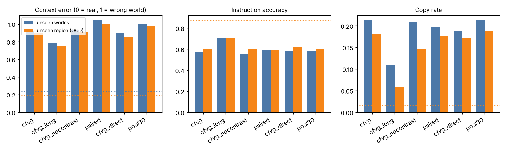
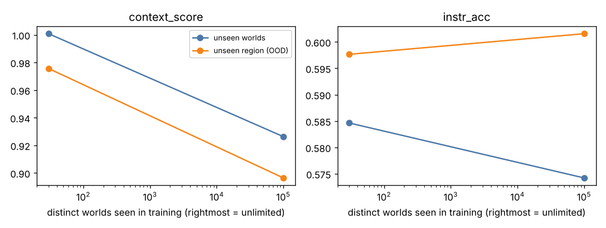

# CFVG synthetic-world experiments: results

## Unseen worlds (inside the training distribution)

| model | context score ↓ | instruction acc ↑ | copy rate ↓ | giant size × (want 2.2) | normal size × (want 1.0) |
|---|---|---|---|---|---|
| *real footage (ceiling)* | 0.239 | 0.878 | 0.005 | 2.203 | 1.009 |
| *wrong world (floor)* | 1.000 | 0.878 | 0.021 | 2.324 | 1.055 |
| *copy a reference* | 0.349 | 0.223 | 0.995 | 0.992 | 1.003 |
| **cfvg** | 0.926 | 0.574 | 0.214 | 2.445 | 1.121 |
| **cfvg_long** | 0.791 | 0.710 | 0.109 | 2.369 | 1.075 |
| **cfvg_nocontrast** | 0.936 | 0.559 | 0.208 | 2.420 | 1.124 |
| **paired** | 1.046 | 0.594 | 0.198 | 0.752 | 1.124 |
| **cfvg_direct** | 0.902 | 0.587 | 0.188 | 2.405 | 1.090 |

Per-attribute error (lower is better):

| model | color | size | gravity | wind | ghost | noise | shape | hold | gravity bias |
|---|---|---|---|---|---|---|---|---|---|
| real | 0.024 | 0.080 | 0.032 | 0.028 | 0.069 | 0.004 | 0.089 | 0.000 | +0.015 |
| wrong world | 0.319 | 0.557 | 0.053 | 0.046 | 0.297 | 0.043 | 0.630 | 0.682 | +0.015 |
| cfvg | 0.047 | 0.400 | 0.067 | 0.061 | 0.308 | 0.037 | 0.661 | 0.677 | +0.004 |
| cfvg_long | 0.035 | 0.231 | 0.074 | 0.054 | 0.271 | 0.012 | 0.635 | 0.693 | +0.013 |
| cfvg_nocontrast | 0.046 | 0.419 | 0.071 | 0.061 | 0.321 | 0.037 | 0.641 | 0.656 | +0.002 |
| paired | 0.051 | 0.878 | 0.071 | 0.068 | 0.281 | 0.036 | 0.651 | 0.677 | -0.014 |
| cfvg_direct | 0.043 | 0.301 | 0.072 | 0.059 | 0.298 | 0.036 | 0.661 | 0.682 | +0.013 |

## Unseen region: stronger gravity than any training world + unseen colour band

| model | context score ↓ | instruction acc ↑ | copy rate ↓ | giant size × (want 2.2) | normal size × (want 1.0) |
|---|---|---|---|---|---|
| *real footage (ceiling)* | 0.195 | 0.871 | 0.016 | 2.177 | 1.001 |
| *wrong world (floor)* | 1.000 | 0.861 | 0.021 | 2.370 | 1.018 |
| *copy a reference* | 0.283 | 0.223 | 1.000 | 1.006 | 1.003 |
| **cfvg** | 0.896 | 0.602 | 0.182 | 2.408 | 1.078 |
| **cfvg_long** | 0.755 | 0.702 | 0.057 | 2.473 | 1.056 |
| **cfvg_nocontrast** | 0.906 | 0.600 | 0.146 | 2.368 | 1.083 |
| **paired** | 1.007 | 0.595 | 0.177 | 0.720 | 1.088 |
| **cfvg_direct** | 0.853 | 0.617 | 0.172 | 2.425 | 1.067 |

Per-attribute error (lower is better):

| model | color | size | gravity | wind | ghost | noise | shape | hold | gravity bias |
|---|---|---|---|---|---|---|---|---|---|
| real | 0.022 | 0.075 | 0.035 | 0.030 | 0.043 | 0.004 | 0.094 | 0.000 | -0.031 |
| wrong world | 0.318 | 0.478 | 0.120 | 0.045 | 0.326 | 0.042 | 0.625 | 0.688 | -0.120 |
| cfvg | 0.046 | 0.357 | 0.133 | 0.057 | 0.333 | 0.037 | 0.630 | 0.682 | -0.130 |
| cfvg_long | 0.033 | 0.253 | 0.126 | 0.053 | 0.277 | 0.012 | 0.635 | 0.703 | -0.124 |
| cfvg_nocontrast | 0.044 | 0.376 | 0.132 | 0.058 | 0.327 | 0.037 | 0.641 | 0.708 | -0.129 |
| paired | 0.048 | 0.727 | 0.145 | 0.060 | 0.320 | 0.037 | 0.615 | 0.682 | -0.139 |
| cfvg_direct | 0.041 | 0.293 | 0.128 | 0.054 | 0.300 | 0.037 | 0.667 | 0.661 | -0.125 |

Snap baseline (never leaves training gravity range) OOD gravity error: 0.045

## World diversity vs zero-shot generalisation

| worlds in training | context score (unseen) | context score (OOD) | instr acc (unseen) | copy rate (unseen) |
|---|---|---|---|---|
| 30 | 1.001 | 0.976 | 0.585 | 0.214 |
| unlimited | 0.926 | 0.896 | 0.574 | 0.214 |

## Training length (main model)

| steps | context score (unseen) | context score (OOD) | instr acc | copy rate | shape err | hold err | ghost err |
|---|---|---|---|---|---|---|---|
| 1500 | 0.962 | 0.930 | 0.406 | 0.396 | 0.708 | 0.615 | 0.316 |
| 4000 | 0.926 | 0.896 | 0.574 | 0.214 | 0.661 | 0.677 | 0.308 |
| 12000 | 0.791 | 0.755 | 0.710 | 0.109 | 0.635 | 0.693 | 0.271 |

## Number of reference clips at inference (trained with 1–3)

| K | context score | instruction acc | copy rate |
|---|---|---|---|
| 1 | 0.799 | 0.707 | 0.057 |
| 2 | 0.792 | 0.711 | 0.094 |
| 3 | 0.791 | 0.710 | 0.109 |
| 5 | 0.786 | 0.711 | 0.151 |
| 8 | 0.788 | 0.712 | 0.188 |

## Text guidance scale

| scale | context score | instruction acc | copy rate |
|---|---|---|---|
| 1.0 | 0.791 | 0.710 | 0.109 |
| 2.0 | 0.777 | 0.809 | 0.036 |
| 3.5 | 0.775 | 0.850 | 0.052 |
