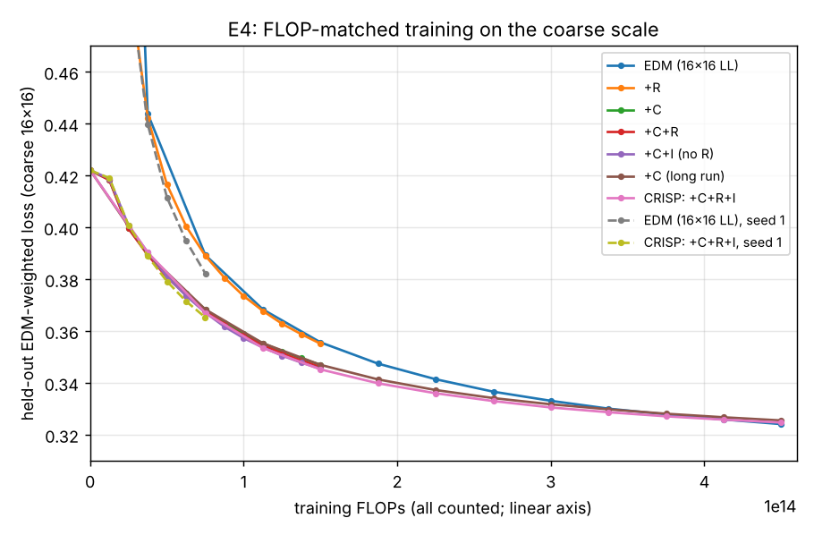
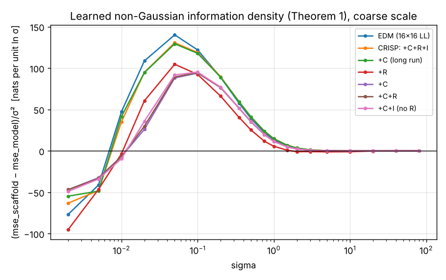

# CRISP diffusion: a first-principles attempt at radically cheaper diffusion training

**Read [`RESEARCH.md`](RESEARCH.md)** for the full study: the information ledger (Theorem 1), the closed-form
noise-marginalized local fields (Theorem 3), 14 hypotheses each tested against evidence, the CRISP framework,
a fully counted cost model for 2×T4, hard limits, and the validation protocol.

This directory also holds a minimal, CPU-runnable PyTorch proof of concept on CIFAR-10. No pretrained components
are used anywhere, evaluation included.

## Layout

```
crisp/
  data.py       CIFAR-10 loading, orthonormal Haar analysis/synthesis
  scaffold.py   Pillar C: class-conditional LMMSE (Wiener) scaffold; stationary spectral variant
  rb.py         Pillar R: exact and stratified (kNN head + uniform tail) empirical-posterior targets
  edm.py        EDM preconditioning, CRISP residual denoiser, Pillar I sampler, Heun sampler, FLOP counting
  nmcr.py       Pillar SP: Noise-Marginalized Closed-form Regression local fields (Theorem 3)
  unet.py       compact class-conditional U-Net
  common.py     patch extraction, coarse-band views, result IO
scripts/
  prepare_data.py      raw downloads -> npz
  exp_analytic.py      E1 gap profile + E2 label-noise analysis
  exp_nmcr.py          E3 closed-form fine-scale field vs SGD-trained U-Nets
  train_global.py      E4 FLOP-budgeted training (EDM / +C / +R / +I, 16x16 or 32x32)
  gap_paired.py        E6 learned non-Gaussian information by noise band (Theorem 1)
  train_classifier.py  self-trained evaluation classifier (features for SC-FID, P/R, accuracy)
  generate_eval.py     E5 end-to-end generation + metrics (--rescore recomputes metrics from saved samples)
  detail_diagnostic.py E5 diagnostic: same coarse samples with the fine band zeroed (also for real images)
  make_report.py       figures + markdown tables (results/results_tables.md)
  build_section7.py    splices the tables into RESEARCH.md §7 (template: sec7_template.md)
  run_training.sh, run_after.sh, run_stage3.sh   the exact pipeline that produced results/
tests/test_core.py     Haar orthonormality, NMCR closed form vs Monte Carlo, RB estimator, LMMSE optimality
results/               JSON logs, figures/, samples_*.npz, results_tables.md
```

## Reproduce (CPU, about 6–7 hours on 4 cores)

```bash
pip install torch numpy scipy matplotlib pillow
# CIFAR-10 PNG tree (fast.ai mirror) and MNIST idx files, then:
python -I scripts/prepare_data.py <cifar10_png_root> <mnist_dir> /home/user/data/npz   # or set CRISP_DATA
python tests/test_core.py
python scripts/exp_analytic.py 4
scripts/run_training.sh && scripts/run_after.sh && scripts/run_stage3.sh   # each stage waits for the previous one
python scripts/generate_eval.py 4 scaffold+nmcr,crisp16+nmcr,edm16+nmcr,edm32,real_train --rescore
python scripts/detail_diagnostic.py
python scripts/make_report.py && python scripts/build_section7.py
```

All FLOPs are counted: network forward and backward (measured with `torch.utils.flop_counter`, which includes the scaffold's
matrix–vector products), retrieval for RB targets, scaffold fitting, and NMCR statistics and solves.

## Honest summary

* The literal goal of 1,000–100,000× less compute with nothing sacrificed is **not** achievable against frontier models:
  memory, capacity and text-data floors rule it out on 2×T4 (RESEARCH.md §6).
* An SD-1.5-class 512² model trained fully from scratch on 2×T4 is **projected** at 16–117 days (central ≈50 days, ≈1.6·10²⁰ FLOPs).
  That is ≈26–190× fewer useful FLOPs than the SD-1.x U-Net + CLIP stack (central ≈60×). Almost all of the factor comes from levers
  already known to the field. Unverified at scale.
* Exact results: Theorem 1 (information ledger) and Theorem 3 (one-pass, all-noise-level closed-form local fields), both checked
  numerically.
* What the proof of concept found, at matched FLOPs on CIFAR-10:
  * The closed-form scaffold is optimal at high noise and gives a robust head start (≈2× early, 1.4× at 1.5·10¹⁴ FLOPs). That head start has
    vanished in held-out loss by 4.5·10¹⁴, but samples still follow the class better (0.34 vs 0.29 classifier accuracy).
  * Rao-Blackwellized targets do nothing (predicted by Proposition 2). Information-allocated σ gives ≈0.5%.
  * The pyramid with closed-form fine fields **loses** end-to-end to a plain pixel-space EDM (SC-FID 12.5 vs 7.6), because at 32×32 the finest
    band is semantic. The high-resolution claim remains untested.

| | |
|---|---|
|  |  |
