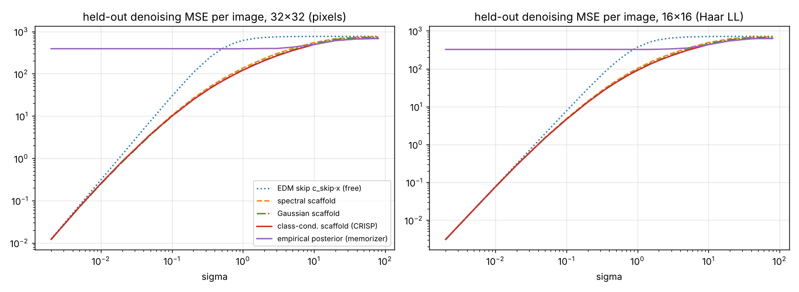
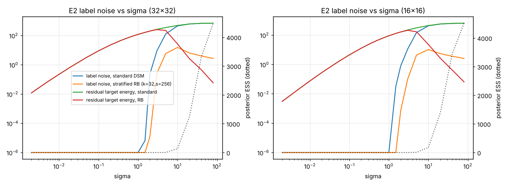
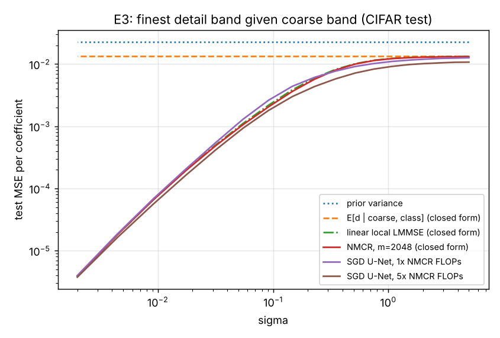
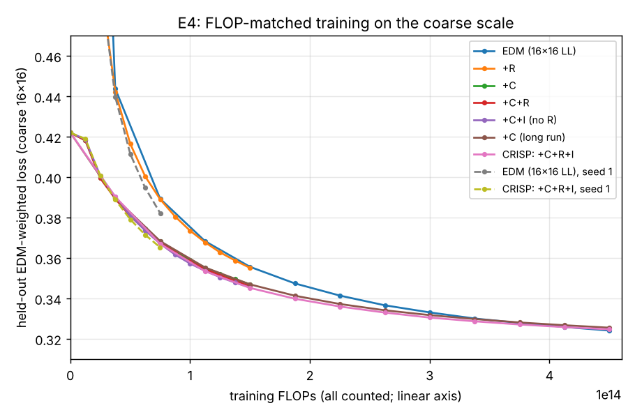
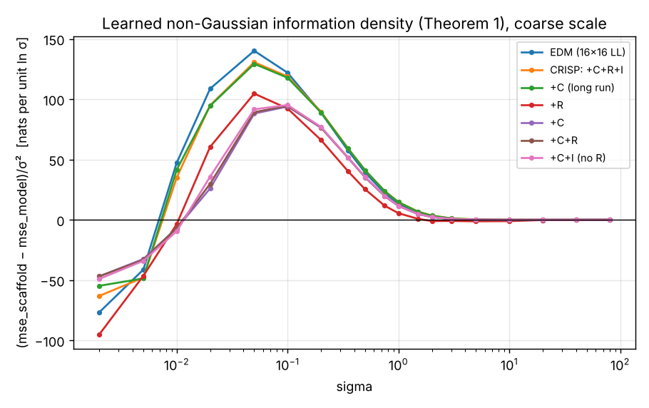
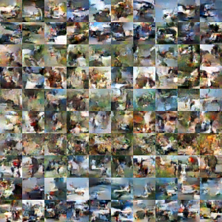
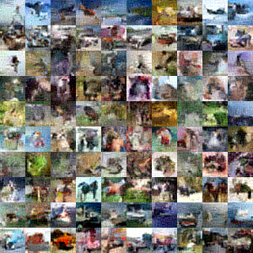
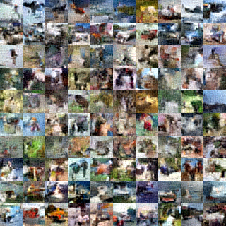

# CRISP: what diffusion training actually has to compute, and how much of it can be skipped

**CRISP** = **C**losed-form scaffolds · **R**ao-Blackwellized targets · **I**nformation-allocated noise
sampling · **S**cale **P**yramid with closed-form local fields.

Every claim in this document carries one of four tags:

| Tag | Meaning |
|---|---|
| **[D]** Demonstrated | Mathematically proven here (proof in the text or Appendix A), or an exact identity checked numerically. |
| **[E]** Experimental observation | Measured in the CPU proof of concept in this repository (CIFAR-10, ≤ 5·10¹⁴ FLOPs per system). Small scale. |
| **[P]** Projection | Extrapolated from the derivations plus published results. Not yet verified at scale. |
| **[S]** Speculation | Plausible, but neither proven nor measured. |

---

## 0. Verdict first

1. **The literal target is out of reach.** A 1,000–100,000× cut in training compute with no loss on any
   axis, measured against frontier models, conflicts with the capacity, memory and text-data floors in §6.
   Two T4s (32 GB in total, no bf16, PCIe interconnect) cannot even hold the optimizer state of an
   8–12 B-parameter frontier model. Whatever the algorithm, the 100,000× end is ruled out on this hardware. **[D]** for the
   memory floor; **[P]** for the rest.
2. **The useful version of the goal, an SD-1.5-class 512² text-to-image model trained entirely from scratch on 2×T4, is
   projected at 16–117 days (central ≈50 days, ≈1.6·10²⁰ FLOPs)** with every component counted and no pretrained
   parts. That is ≈26–190× fewer useful FLOPs than SD-1.x's U-Net + CLIP stack (central ≈60×), or ≈200–1,500× by the
   A100-hour accounting on the SD model card. **[P]** The 1,000× target is met only in the optimistic scenario and only
   under the wall-clock accounting. **Almost all of this factor comes from levers already known to the field**: fewer, better
   samples; a transformer that sees only a 32×32×3 coarse band; masking; and a small text encoder that costs prompt
   fidelity.
3. **What is new** (to my knowledge; see §9):
   - **Theorem 1 (information ledger).** The only information a denoiser must learn beyond one pass of
     second-order statistics is $D(p\,\|\,\mathcal N(\mu,\Sigma)) = \tfrac12\int_0^\infty
     [\mathrm{lmmse}(s)-\mathrm{mmse}(s)]\,ds$. Its density over noise levels, $\mathrm{gap}(\sigma)/\sigma^2$,
     says where training compute can do any good. **[D]** Measured on CIFAR **[E]**, ≈0 learnable information lies above σ = 5,
     and EDM networks are still worse than the free closed-form scaffold there after 4.5·10¹⁴ FLOPs.
   - **Theorem 3 (NMCR).** For random-Fourier-feature local denoisers, the normal equations integrated *exactly*
     over the Gaussian noise are elementwise products of noise-independent data statistics with closed-form
     σ-kernels. One pass over clean data therefore trains the field at **every noise level at once**: no noise
     sampling, no noise-level sampling, no backprop, no epochs. **[D]**, and checked against Monte Carlo to 10⁻⁴–3·10⁻³ relative error **[E]**.
   - **Proposition 2 (where label noise lives).** Rao-Blackwellized targets leave the expected gradient
     unchanged **[D]**. But in high dimension the empirical posterior is one-hot for every σ below roughly the
     nearest-neighbour scale, so RB targets equal standard targets exactly where most training happens. **[E]**
4. **The proof of concept (§7) mostly falsified the hope of a large multiplicative factor**, and I report it that way:
   - The scaffold gives a **head start, not a lasting speed-up**: ≈2× fewer FLOPs early, 1.4× at 1.5·10¹⁴, and equal held-out loss
     by 4.5·10¹⁴. It does give lasting gains at high noise, and noticeably better class adherence of samples at equal FLOPs
     (classifier accuracy 0.34 vs 0.29).
   - RB targets: **no effect** (as Proposition 2 predicts). Information-allocated σ: ≈0.5%.
   - Pyramid with closed-form fine fields **lost** end-to-end to a standard pixel-space EDM at matched FLOPs on CIFAR-10 32×32
     (self-trained-feature FID 12.5 vs 7.6). The diagnostic: at 32×32 the finest Haar band carries semantic content
     (removing it from *real* images drops classifier accuracy from 0.90 to 0.30), so locality fails there. The 512² claim is untested.
   - NMCR is exact and cheap (97 s for all 18 σ) and beats an SGD U-Net of equal FLOPs at low noise. It loses at high noise and to a U-Net
     with 5× the FLOPs, and is barely better than a *linear* local field. Its limit is expressivity, not optimization.

---

## 1. The target in numbers

| Quantity | Value | Note |
|---|---|---|
| T4 peak (fp16 tensor cores) | 65 TFLOP/s | 8.1 TFLOP/s fp32; **no bf16**; 16 GB GDDR6 at 320 GB/s; 70 W |
| Realistic sustained, 2×T4 | 2 × (12–30) TFLOP/s | the planning value here is **2 × 20 = 4·10¹³ FLOP/s** (31% of peak) |
| 2×T4, 30 days | ≈ 1.0·10²⁰ FLOPs | at the planning throughput |
| SD-1.x U-Net, useful FLOPs | ≈ 6.7·10²¹ | 237k steps at 256² + 1.30M steps at 512², batch 2048, ≈0.8 TFLOP/forward at 512² (×3 for training) |
| CLIP ViT-L/14 (SD-1.x text encoder) | ≈ 3.3·10²¹ | 12.8 B samples × 3 × ≈87 GFLOP |
| SD-1.x stack, useful FLOPs | **≈ 1·10²²** | VAE excluded (small) |
| SD-1.x by wall-clock | ≈ 7.9·10²² | 150k A100-hours (model card) at 40% MFU ≈ 6.7·10²², plus CLIP's 73.7k V100-hours at 35% ≈ 1.2·10²² |
| Frontier (8–12 B-parameter image models) | ≳ 10²³–10²⁴ | not public; order of magnitude only |

"1,000× vs SD-1.x" therefore means 10¹⁹ (strict) to 8·10¹⁹ (wall-clock) FLOPs, or 3–23 days on 2×T4.
"100,000× vs frontier" means ~10¹⁹ FLOPs while matching a model with ≳10 B parameters.

---

## 2. First principles: an information ledger for diffusion training

Forward process (EDM / variance-exploding form): $x_\sigma = x_0 + \sigma\varepsilon$, $\varepsilon\sim\mathcal N(0,I)$,
$x_0\in\mathbb R^d$. The optimal denoiser is $D^*(x,\sigma)=\mathbb E[x_0\mid x_\sigma=x]$. Tweedie's formula gives
$\nabla\log p_\sigma(x) = (D^*(x,\sigma)-x)/\sigma^2$. Training minimizes
$\mathcal L(\theta)=\mathbb E_{\sigma\sim p}\,\lambda(\sigma)\,\mathbb E\|D_\theta(x_\sigma,\sigma)-x_0\|^2$.

### 2.1 Exact decomposition of the denoising loss  [D]

For any denoiser $D$ (a function of $x_\sigma$), orthogonality of $x_0-D^*$ to functions of $x_\sigma$ gives

$$\mathbb E\|D-x_0\|^2=\underbrace{\mathrm{mmse}(\sigma)}_{\text{irreducible}}+\underbrace{\mathbb E\|D-D^*\|^2}_{\text{excess}} .$$

Let $D_G(x,\sigma)=\mu+\Sigma(\Sigma+\sigma^2 I)^{-1}(x-\mu)$ be the Wiener filter built from the data mean and covariance. It is the
best *affine* estimator for **any** distribution with those two moments. Its error
$\mathrm{lmmse}(\sigma)=\sum_k\lambda_k\sigma^2/(\lambda_k+\sigma^2)$ needs only the eigenvalues. Applying the decomposition to $D=D_G$:

$$\mathrm{gap}(\sigma):=\mathrm{lmmse}(\sigma)-\mathrm{mmse}(\sigma)=\mathbb E\|D^*-D_G\|^2\;\ge 0 .$$

So **at noise level σ, the only thing any network can add beyond one pass of second-order statistics is the
residual $D^*-D_G$, whose energy is $\mathrm{gap}(\sigma)$.** Where the gap is zero, training compute is wasted.

### 2.2 Theorem 1: the non-Gaussian information identity  [D]

Write snr $s=1/\sigma^2$ and $Y=\sqrt s\,x_0+\varepsilon$. Let $x_0$ have a density $p$ with finite covariance Σ, and let
$G=\mathcal N(\mu,\Sigma)$. Then

$$\boxed{\;D(p\,\|\,G)=\tfrac12\int_0^\infty\big[\mathrm{lmmse}(s)-\mathrm{mmse}(s)\big]\,ds
=\int_{0}^{\infty}\frac{\mathrm{gap}(\sigma)}{\sigma^{2}}\,d\ln\sigma\;}$$

with the analogous statement conditional on a label or prompt, using $\mathcal N(\mu_c,\Sigma_c)$.

*Proof.* The I-MMSE relation (Guo, Shamai & Verdú 2005) gives $\tfrac{d}{ds}I(x_0;Y)=\tfrac12\mathrm{mmse}(s)$. For the Gaussian with
the same covariance, the MMSE equals the LMMSE, which depends only on second moments. Hence $\tfrac{d}{ds}I_G=\tfrac12\mathrm{lmmse}(s)$, and
$I_G(s)-I(s)=\tfrac12\int_0^s(\mathrm{lmmse}-\mathrm{mmse})$. As $s\to\infty$, $I(s)=h(\sqrt s x_0+\varepsilon)-h(\varepsilon)=\tfrac d2\ln s+h(x_0+\varepsilon/\sqrt s)-h(\varepsilon)$, so
$I_G(s)-I(s)\to h(G)-h(p)$. Since $G$ matches $p$'s first two moments, $h(G)-h(p)=D(p\|G)$. The change of variables
$ds=2s\,d\ln(1/\sigma)$ gives the second form. ∎

**Consequences.**
* The total information that *must* be learned by iterative optimization is the negentropy $D(p\|G)$. Everything
  else is available in closed form from one pass. **[D]**
* $\rho(\sigma)=\mathrm{gap}(\sigma)/\sigma^2$ is the **learnable-information density** per unit log-noise. Noise levels with
  ρ ≈ 0 carry no information a network can extract. Spending SGD samples there is pure overhead. **[D]**
* For 8-bit data the true density is discrete and $D(p\|G)=\infty$. The integral restricted to $\sigma\ge\sigma_{\min}$ is finite
  and is the non-Gaussian information resolvable above the quantization scale.
* A trained network's error upper-bounds mmse, so $\tfrac12\int(\mathrm{lmmse}-\mathrm{mse}_\theta)\,ds\le D(p\|G)$. By Verdú's
  mismatched-estimation identity (Verdú 2010), if $D_\theta$ were the exact posterior-mean denoiser of a model density
  $q_\theta$, this quantity would equal $D(p\|G)-D(p\|q_\theta)$: the number of nats by which the model is closer to the data than the
  free Gaussian scaffold. For a real network the identity holds only approximately. §7 reports this "captured non-Gaussian information"
  per noise band (E6).

### 2.3 Where the label noise of denoising score matching lives  [D] + [E]

Standard DSM regresses $D_\theta(x_\sigma)$ onto $x_0$. Given $x_\sigma$, the target $x_0$ is random. Under the **empirical** training
distribution the conditional mean has a closed form:
$\hat y(x_\sigma)=\sum_j\pi_j x_0^{(j)}$ with $\pi_j\propto e^{-\|x_\sigma-x_0^{(j)}\|^2/2\sigma^2}$.

**Proposition 2.** (a) $\mathbb E[\nabla_\theta\|D_\theta-x_0\|^2\mid x_\sigma]=\nabla_\theta\|D_\theta-\hat y\|^2$. Replacing $x_0$ by $\hat y$
(Rao-Blackwellization) leaves the expected gradient *exactly* unchanged and removes the label-noise term
$\mathbb E\|J^\top(\hat y-x_0)\|^2$ from its variance. The remaining gradient noise is proportional to the
*excess* loss, so it vanishes as the model improves. This is the "strong growth" regime in which SGD converges at
deterministic rates (Vaswani et al. 2019). (b) The label-noise energy is the posterior variance
$V(\sigma)=\mathbb E\big[\sum_j\pi_j\|x_0^{(j)}-\hat y\|^2\big]$. It is zero whenever the posterior is one-hot, i.e. whenever
$\sigma^2$ is small relative to the gap between the squared distances from $x_\sigma$ to its first and second nearest training
images.

Part (a) is exact (proof in A.2). Part (b) is the catch, and §7 / `results/analytic.json` measures it **[E]**. On CIFAR-10 pixels
(d = 3072, 5k images per class) the posterior's effective sample size is 1.0 (to one decimal) for every σ ≤ 2,
and $V(\sigma)\le 0.12\%$ of the residual energy there. Label noise becomes noticeable at σ = 3 (3.4% of the residual)
and dominates from σ = 10. EDM's training distribution (log-normal, median σ = 0.3) puts ≈94% of its samples at σ ≤ 2,
where RB targets *equal* the standard ones, and ≈97% at σ ≤ 3.
**Rao-Blackwellization cannot speed up the part of training that matters most.** It helps only at high noise, and E1
shows that is exactly where the closed-form scaffold is already optimal (gap ≈ 0). The two mechanisms overlap. This
is the clearest example in this study of why "multiply all the speed-ups together" overstates the total (§6, L4).

The real "noise" SGD fights at mid σ is *model-relative*: the network cannot represent the memorizing posterior, so
$x_0-D_{\theta^*}$ acts as noise even though the empirical posterior is deterministic. Reducing that would need a
*generalizing* posterior target (for example the patch-local posterior of Kamb & Ganguli's ELS machine). Such a target is biased,
and is left as hypothesis H3′ (§3).

### 2.4 Audit of every ingredient of conventional training

| Ingredient | What it computes | Redundant part | Max saving from removing that part | Status |
|---|---|---|---|---|
| Back-propagation | exact gradient; ≈2× forward cost | none of its *information* is redundant | ≤ 3× per step, and every known alternative needs more steps | [D] bound, [E] literature |
| Gradient descent | first-order steps | curvature ignored | 1.3–2× fewer steps (Shampoo/SOAP-type preconditioning); exact solves only for linear-in-parameter blocks | [E] literature |
| Many noise levels | regression at every σ | σ where gap(σ) ≈ 0 | fraction of samples in those σ: ~1.1× for EDM on CIFAR, up to ~2× for high-res schedules shifted to high noise | [D] + [E] |
| Noise sampling (Monte Carlo over ε) | stochastic estimate of a Gaussian integral | all of it, *for linear-in-features models* | exact integration (Theorem 3) | [D] |
| Random initialization | starts from D ≈ c_skip·x | the affine part of D* | scaffold init: held-out loss at step 0 is 0.42 vs 1.01 (CIFAR LL) | [E] |
| Repeated exposure (epochs) | re-reading data | sufficient statistics of linear blocks | one pass for scaffold and fine fields; the global model still needs several epochs | [D] |
| Dense global compute at all resolutions | attention/conv over every pixel at every layer | fine scales are local given coarser ones | 16–256× fewer positions at the expensive model | [P], [E] literature |
| Dense matmul | all parameters, all tokens | masked / dropped tokens; experts | 2–3× (MaskDiT, deferred masking) | [E] literature |
| Representation learning | semantics | **none removable** without external data or models | — (this is the irreducible core) | [P] |
| Noise schedule | weights per σ | mis-allocation | ≤ 2× | [E] literature |

The honest reading: **no single ingredient hides a 1,000× redundancy.** The large factors come from (i) removing whole
*dimensions* from the expensive model (multiscale locality), and (ii) removing whole *categories* of computation for
the parts of the problem with closed-form structure: second-order statistics, high noise, and fine-scale local
fields.

---

## 3. Fourteen hypotheses, each attacked

Format for each: **Mechanism · Cost · Potential gain · Does it keep generative ability? · Limits · Prior work ·
Falsification attempt · Verdict.**

**H1. Closed-form empirical-Bayes diffusion (no network at all).**
Mechanism: use $\hat y(x_\sigma)$ from §2.3 as the denoiser. Cost: 0 training, $O(Nd)$ per sampling step.
Gain: unbounded on training. Ability: **no**. Sampling the exact empirical score returns training images.
Prior: folklore; Scarvelis et al. 2023 ("closed-form diffusion models") smooth it. Falsification **[E]**: on held-out
CIFAR images the empirical posterior's denoising MSE is ≈390 at every σ ≤ 1, against 0.01–121 for the Gaussian scaffold.
It snaps test images onto training images. **Rejected** as a model. Kept as a target estimator (H3).

**H2. Analytic Gaussian / spectral scaffold for high noise.**
Mechanism: the Wiener filter $D_G$ (full covariance, class- or prompt-conditional), or its stationary version, which is diagonal per
frequency with a C×C cross-spectrum. Cost: $O(Nd^2+d^3)$ or $O(Nd\log d)$ in one pass. Gain: makes high-σ training
unnecessary and gives a far better skip connection than EDM's $c_\text{skip}x$ (that term is the LMMSE under an
*isotropic* prior). Ability: no multimodality, so it is a scaffold, not a model. Prior: Wang & Vastola 2023/2024 show
trained scores are close to the Gaussian score at moderate and high noise, and use this to skip 15–30% of *sampling*
steps. They do not use it to remove *training*. Falsification **[E]**: at σ = 20 the class-conditional scaffold's test MSE is
608.78 against 608.55 for the exact empirical posterior (0.04% apart). At σ = 1 it beats EDM's skip term 5×
(121 vs 613). E4/E6 **[E]**: as a skip path in training it gives a head start (held-out loss 0.42 at step 0 vs 1.01) that is worth
a fixed ≈4·10¹³ FLOPs and has vanished by 4.5·10¹⁴. At σ ≥ 10 it stays far better than a trained EDM network (σ = 20: 549 vs 642 per
image), and samples from the scaffold-based model follow the class better (accuracy 0.34 vs 0.29). It is slightly *worse* at σ < 0.05,
where shrinkage based on estimated small eigenvalues hurts. **Accepted, as a head start and high-noise solver, not a multiplicative speed-up.**

**H3. Rao-Blackwellized (posterior-mean) targets.**
Mechanism: Proposition 2. Scalable estimator: exact head over k approximate nearest neighbours (IVF index on a
PCA sketch) plus a uniformly sampled tail with importance weight (N−k)/s. Cost ≈ $B[N r/n_\text{list}\cdot n_\text{probe}+(k+s)d]$,
about 10⁻⁴ of a network forward at scale. Gain: in theory, deterministic-rate SGD wherever the posterior is spread.
Prior: Stable Target Field (Xu, Tong & Jaakkola, ICLR 2023) uses a reference batch, which has larger bias. Falsification
**[E]**: label noise is zero for σ ≤ 2 on CIFAR (§2.3). At σ ≥ 5 the stratified estimator cuts it 20–250× (σ = 10:
455 → 15; σ = 80: 700 → 2.7). In training (E4), +R alone gives 0.3551 vs EDM's 0.3557 at 1.5·10¹⁴ FLOPs, and +C+I without R
equals full CRISP (0.3454 vs 0.3452). My claim that I needs R was falsified too. **Falsified as a speed-up at this scale:** the variance
it removes sits where the scaffold has already solved the problem.
*H3′ (open):* targets from a generalizing *local* posterior (patch mosaics), annealed to unbiased targets. **[S]**

**H4. Information-allocated noise-level sampling.**
Mechanism: Theorem 1 says where learning can happen. Sample σ from $q\propto p\cdot\sqrt{\mathbb E[\ell^2\mid\sigma]}$, the
variance-optimal importance-sampling proposal (A.4), with weights $p/q$ so the objective is unchanged. With *standard* targets, ℓ at high σ is dominated by
irreducible mmse, so this proposal (as in iDDPM) allocates *more* samples to high noise, which is the wrong direction. With
scaffold + RB targets, ℓ becomes the excess loss, so the proposal learns to skip what is already solved. Cost: negligible. Gain: bounded by the
mass p puts on ρ ≈ 0, so ≤1.2× for EDM-CIFAR and up to ~2× for schedules shifted toward high noise. Measured **[E]**: +C+I 0.3454 vs
+C 0.3470 at 1.5·10¹⁴ (≈0.5%). The learned proposal moved samples toward *low* σ (q/p up to 2.5) and away from σ ≈ 0.4–1.5 (q/p ≈ 0.7).
**Weak; keep only for schedules with heavy high-noise mass.**

**H5. Multiscale factorization with local conditionals (scale pyramid).**
Mechanism: for an orthonormal wavelet transform, $p(x)=p(x^{(J)})\prod_j p(d^{(j)}\mid x^{(j)})$. The chain rule makes this exact,
and orthonormality means pixel noise σ is coefficient noise σ. Hypothesis: at fine scales the conditional score is local
(Markov in a small neighbourhood). Cost: the expensive global model sees $d/4^J$ dimensions. Fine fields cost
O(pixels). Gain: 16–256× fewer positions in the expensive model, and fine fields need no global compute. Ability:
preserved *if* locality holds; it fails for long-range fine structure such as text glyphs and symmetric faces, which intermediate scales must handle
with larger receptive fields. Prior: Kadkhodaie, Guth, Mallat & Simoncelli (ICLR 2023) show
face structure is captured with much smaller conditioning neighbourhoods than a pixel-domain Markov model needs.
Guth et al. (NeurIPS 2022) show a constant number of sampling steps per scale. Falsification **[E]** at 32×32 (one level):
the pyramid lost end-to-end to pixel-space EDM at matched FLOPs (SC-FID 12.5 vs 7.6). Real images with the finest band zeroed reach
only 0.30 classifier accuracy (vs 0.90), so at this resolution the finest band is semantic, not texture, and the local Markov
assumption fails. **Unresolved at the resolutions where it matters (256²→512²); falsified for 32² CIFAR.** It remains the only
lever here that removes *dimensions* from the expensive model, and therefore the first thing Stage A of §8 must test.

**H6. Noise-marginalized closed-form regression (NMCR) for local fields.**
Mechanism: Theorem 3 (§4.5). Cost: $N_p(d_\text{in}+m)^2$ once, plus one $(d_\text{in}+m)^3$ solve per σ. Gain over SGD
local nets: no noise Monte Carlo, no epochs, no backprop, no learning-rate tuning, and the validation loss is also closed
form. In absolute terms fine fields become ≈10¹⁶ FLOPs at 512². Ability: limited by random-feature
expressivity in 100–200 input dimensions. Limits: only the first layer of a deep net can be noise-marginalized, so the method
**requires locality (H5)** to keep input dimension low. Prior: random features (Rahimi & Recht 2007); kernel denoisers.
I know of no prior use of σ-independent sufficient statistics that train all noise levels at once. Falsification: E3 (§7)
compares against SGD-trained U-Nets at 1× and 5× the FLOPs **[E]**. NMCR wins at low noise against 1× (σ = 0.15: 0.00363 vs 0.00439) and loses at
σ ≥ 0.25. It loses everywhere to 5×, and is only 1–4% better than a *linear* local field. Its details still improve generated samples a lot
(SC-FID 18.1 → 12.5 vs zeroed details). **Accepted as exact, cheap machinery; its expressivity (5×5 context, random features in 166
dimensions) is the bottleneck.** Fix to try: larger linear context plus learned (not random) low-dimensional features.

**H7. Backprop-free learning (forward-forward, feedback alignment, predictive coding, NoProp).**
Ceiling: the backward pass is ≈2/3 of step FLOPs, so per-step savings are ≤3× **[D]**. Bio-plausible rules scale poorly
(Bartunov et al. 2018). NoProp (2025) targets classification. **Rejected** for compute. Memory benefits are real.

**H8. Analytic weight construction for deep networks (NTK regression, scattering / PCA-nets).**
NTK regression costs $O(N^2)$ memory and $O(N^3)$ time (impossible at N = 3·10⁷) and lacks feature learning. Fixed
scattering front-ends replace the *cheapest* part of learning (low-level filters). **Rejected**, except for the
analytic wavelet front-end, which is what H5 already is.

**H9. Data reduction (deduplication, coresets, distillation).** Semantic deduplication removes ~50% of web data with
minimal loss for CLIP-type models (Abbas et al. 2023). Generative dataset distillation is not shown at scale.
**Accepted as hygiene, ≤2×.**

**H10. Sparse and dynamic compute (token masking, MoE).** MaskDiT and deferred masking (Sehwag et al. 2024/25: 1.16 B
parameters, 37M images, $1,890, 2.6 days on 8×H100, COCO FID 12.7, ~14× cheaper than the previous cheapest approach) show
2–3× from masking. **Accepted (known).**

**H11. Closed-form semantic scaffold (text → coarse image statistics).**
Mechanism: word embeddings from a one-pass co-occurrence count plus a truncated SVD of the PPMI matrix
(Levy & Goldberg 2014: skip-gram ≈ implicit PMI factorization). Then a *conditional* LMMSE scaffold
$\mu(c)=A\psi(c)+b$, $\Sigma_{x|c}=\Sigma_{xx}-\Sigma_{x\psi}\Sigma_{\psi\psi}^{-1}\Sigma_{\psi x}$ (A.3). Gain: the
prompt-dependent global colour and layout prior is solved before training starts. Limits: bag-of-words, so no binding
("red cube left of a blue ball"). **Accepted as a scaffold**, insufficient alone **[P]**.

**H12. Scale recursion (share fine fields across scales).** Natural images have approximately scale-invariant
statistics (1/f² spectra), so a single local field with a scale-index input could serve every octave and extend to unseen resolutions
with no training. Limits: real images have characteristic scales. **Plausible, untested [S].**

**H13. Mixture-of-factor-analyzers scaffold (multimodal, closed form at all σ).** A noised MFA is still an MFA, so its score is
analytic for every σ. Richardson & Weiss (2018) showed MFAs with many components capture image diversity well.
Evidence here **[E]**: the class-conditional Gaussian (an MFA with 10 known, full-rank components) improves on the
unconditional scaffold by only 4% at σ = 5 on CIFAR pixels. Multimodality by class barely reduces the gap, which suggests
modest returns. **Open; low priority.**

**H14. Representation alignment without external encoders.** REPA's 17.5× uses DINOv2, a pretrained model trained on
142M curated images, so it is excluded here and its cost would have to be counted. Self-alignment variants recover part of the gain.
**Optional; modest [P].**

| # | Idea | Verdict | Expected factor at scale |
|---|---|---|---|
| H1 | empirical-Bayes closed form | rejected (memorizes) | — |
| H2 | Gaussian / spectral scaffold | **accepted** (head start + high-noise solver) | fixed offset ≈4·10¹³ FLOPs at PoC scale; better class adherence [E] |
| H3 | RB targets | **falsified** at this scale | 1.00× [E] |
| H4 | information-allocated σ | weak | ≈1.005× [E] |
| H5 | scale pyramid with local fields | falsified at 32²; open at 512² | 4–16× fewer positions *if* locality holds [P] |
| H6 | NMCR closed-form fields | machinery accepted, expressivity insufficient | fine-scale training → ~0 FLOPs [D] |
| H7 | backprop-free | rejected | ≤3× ceiling, worse in practice |
| H8 | NTK / analytic deep weights | rejected | — |
| H9 | data hygiene | accepted (known) | ≤2× |
| H10 | masking / MoE | accepted (known) | 2–3× |
| H11 | closed-form text scaffold | accepted as scaffold | small, grows with H2 |
| H12 | scale recursion | untested | resolution for free [S] |
| H13 | MFA scaffold | open | small (evidence) |
| H14 | self-representation alignment | optional | 1.3–2× [P] |

---

## 4. The invention: CRISP

### 4.1 Generative factorization

Orthonormal Haar (or any orthonormal wavelet) analysis $x\mapsto(x^{(J)},d^{(J)},\dots,d^{(1)})$, exact by the chain rule:

$$p(x\mid c)=\underbrace{p(x^{(J)}\mid c)}_{\text{coarse: learned + scaffold}}\;\prod_{j=J}^{J_m}\underbrace{p(d^{(j)}\mid x^{(j)},c)}_{\text{mid: small learned local conv fields}}\;\prod_{j<J_m}\underbrace{p(d^{(j)}\mid x^{(j)},c)}_{\text{fine: NMCR closed form}} .$$

For 512² images: J = 4, so the coarse level is 32×32×3 (3,072 dimensions; Torralba et al. 2008 found 32×32 colour
thumbnails sufficient for human scene and object recognition). Mid levels produce 64² and 128²; fine levels produce 256² and 512².
Every level is a conditional diffusion with its own σ range. Orthonormality makes each level's forward
process an ordinary $x_\sigma=x_0+\sigma\varepsilon$ in coefficient space.

### 4.2 Pillar C: closed-form scaffolds

**Coarse level.** Conditional LMMSE from the pair (noisy coarse image, text feature ψ(c)) (derivation in A.3):

$$D_G(x,\sigma,c)=\mu(c)+\Sigma_{x|c}\,(\Sigma_{x|c}+\sigma^2I)^{-1}\,(x-\mu(c)),\qquad \mu(c)=\mu+\Sigma_{x\psi}\Sigma_{\psi\psi}^{-1}(\psi(c)-\mu_\psi).$$

Eigendecompose $\Sigma_{x|c}=U\Lambda U^\top$ once. Then $D_G$ costs two dense matrix–vector products. With labels instead of prompts (the proof of concept), $\mu(c),\Sigma_c$ are
per-class moments shrunk toward the pooled covariance.

**Text features ψ(c).** One pass over captions counts word co-occurrences. Take a truncated SVD of the PPMI matrix
(rank 512), average over caption tokens, and append bigram hashes. This is closed form, costs ≈10¹⁵ FLOPs on CPU, and also initializes the
embedding table of the small learned text encoder.

**Residual parametrization.** The learned coarse denoiser is

$$D_\theta(x,\sigma,c)=D_G(x,\sigma,c)+c_\text{out}(\sigma)\,F_\theta\big([c_\text{in}(\sigma)x,\;D_G/\sigma_\text{data}],\,c_\text{noise}(\sigma),\,c\big),$$

with EDM's $c_\text{in},c_\text{out},c_\text{noise}$ and EDM's loss weight λ(σ), so **the objective is identical to EDM's** and only the
skip path changes. EDM's $c_\text{skip}x$ is the LMMSE under an isotropic $\mathcal N(0,\sigma_\text{data}^2I)$ prior, and CRISP
replaces it with the full LMMSE. The output layer is zero-initialized, so **the model at step 0 is already the optimal affine
denoiser**.

### 4.3 Pillar R: Rao-Blackwellized targets (stratified posterior)

*Status after the proof of concept: no measurable benefit (§7, E4). Kept in the codebase and described here because the
negative result is informative; it is dropped from the costed configuration in §5.*

For a training pair $(x_0^{(i)},c_i)$ and noisy $x_\sigma$:
1. $q=P^\top(x_\sigma-\bar x)$ (PCA sketch, r = 64–256). IVF lookup gives a head $K$ of k approximate nearest neighbours of $q$
   within the same class or caption cluster. Always add $i$ itself.
2. Draw a tail $S$ of s indices uniformly. Mask entries already in $K$. Each surviving tail entry carries log-weight $\ln\frac{N-k}{|S\setminus K|}$.
3. Compute exact logits $\ell_j=(x_\sigma\cdot x_0^{(j)}-\tfrac12\|x_0^{(j)}\|^2)/\sigma^2$ in full dimension for $j\in K\cup S$, take the softmax, and form the target
   $\hat y=\sum_j w_jx_0^{(j)}$.

With exact head and tail sums the estimator is consistent. Its bias comes only from self-normalization of the tail and vanishes as
s grows. Its residual error against the exact posterior is measured in E2 (`V_strat`). For text conditioning, captions
are almost all unique, so the exact empirical conditional posterior is one-hot. The posterior is therefore taken over a *caption-kernel* neighbourhood
($\pi_j\propto e^{-\|x_\sigma-x_0^{(j)}\|^2/2\sigma^2}\,k_h(\psi_i,\psi_j)$, bandwidth h → 0 over training). By §2.3, use it only for
σ above the empirical ESS threshold (ESS > 1.5, estimated once on a σ grid).

### 4.4 Pillar I: information-allocated noise levels

*Status: ≈0.5% effect at the scale tested (§7, E4). Optional.*

Twenty-four bins in ln σ. Each bin keeps an EMA of $\ell^2$, where ℓ is the λ-weighted per-sample loss against the RB target. The proposal is
$q(\sigma)\propto p(\sigma)\,[(1-\phi)\,r(\sigma)/\bar r+\phi]$ with $r=\sqrt{\mathrm{EMA}(\ell^2)}$ and floor φ = 0.2. Each sample's loss
is weighted by $p/q=\bar r/r$. Because ℓ is the *excess* loss (Prop. 2), r(σ) tracks the remaining learnable information
ρ(σ) of Theorem 1, and the sampler stops paying for noise levels the scaffold has already solved.

### 4.5 Pillar SP: the pyramid, and Theorem 3 (NMCR)

**Mid levels (64², 128²)** are small conditional U-Nets (~30M parameters each). Each takes the noisy detail band, the clean
coarser band and a pooled text embedding, has a receptive field of about 32–64 coefficients, and trains with EDM on random crops.
Patch-level data is plentiful and the conditional problem is well conditioned, so they converge with few image-level passes
(Guth et al. 2022).

*Status: at 32² the closed-form fine field was too weak (§7, E3/E5). At 512² the finest bands are far more local, but that is untested.
The fallback is a small learned local conv field per fine level, ≈5·10¹⁸ FLOPs in total, which keeps the §5 totals within their range.*

**Fine levels (256², 512²): NMCR.** At site $u$ the local field predicts the clean detail vector $y=d_0[u]\in\mathbb R^{9}$ from
$z_\sigma=[\text{noisy }3{\times}3\text{ detail patch};\ \text{clean }5{\times}5\text{ coarse patch};\ \text{text or class code}]$,
i.e. $z_\sigma=z_0+\sigma M\varepsilon$ with $M$ selecting the noisy coordinates. Features:

$$\phi(z)=\big[1,\;z,\;\sqrt{2/m}\cos(Wz+b)\big],\qquad W\in\mathbb R^{m\times d_\text{in}} \text{ (multi-bandwidth Gaussian rows)} .$$

**Theorem 3.** Let $u_k=M^\top w_k$, $A_k=w_k\!\cdot z_0+b_k$, $C_k=\cos A_k$, $S_k=\sin A_k$, $e_k(\sigma)=e^{-\sigma^2\|u_k\|^2/2}$,
$E^{\mp}_{kl}(\sigma)=e^{-\sigma^2\|u_k\mp u_l\|^2/2}$. Then, with expectations over $\varepsilon$ conditional on $z_0$:

$$\begin{aligned}
\mathbb E[\phi_k] &= \sqrt{2/m}\,e_kC_k, &
\mathbb E[\phi_k\phi_l] &= \tfrac1m\big[E^-_{kl}(C_kC_l+S_kS_l)+E^+_{kl}(C_kC_l-S_kS_l)\big],\\
\mathbb E[z_\sigma\phi_k] &= \sqrt{2/m}\,e_k\big(z_0C_k-\sigma^2Mu_kS_k\big), &
\mathbb E[z_\sigma z_\sigma^\top] &= z_0z_0^\top+\sigma^2MM^\top .
\end{aligned}$$

Hence the noise-integrated Gram matrix and right-hand side are

$$G(\sigma)=\mathcal K(\sigma)\odot\mathcal S,\qquad B(\sigma)=\kappa(\sigma)\odot\mathcal T ,$$

where $\mathcal S=\{\overline{z_0z_0^\top},\overline{z_0C^\top},\overline{CC^\top},\overline{SS^\top},\bar z_0,\bar C,\bar S\}$ and
$\mathcal T=\{\bar y,\overline{z_0y^\top},\overline{Cy^\top}\}$ are averages over **clean** data that **do not depend on σ**, and
$\mathcal K,\kappa$ are the closed-form kernels above. *Proof:* Gaussian characteristic function, product-to-sum
identities, and Stein's lemma $\mathbb E[\varepsilon f(\varepsilon)]=\mathbb E[\nabla f]$ (A.1). ∎

**Corollary.** One pass over clean data, costing $N_p[2d_\text{in}m+2(d_\text{in}+m)^2+2m^2]$ FLOPs, followed by one
$(1+d_\text{in}+m)^3/3$ Cholesky per σ, yields the *exact population least-squares* local denoiser for every noise level of the
sampler, which is what infinitely many SGD epochs with infinitely many noise draws would converge to within this function class. The
population training loss and a held-out loss are also closed form ($\bar{yy}-2\langle W,B\rangle+\langle W,GW\rangle$), and we use the
held-out loss to choose the ridge per σ with no Monte Carlo. **[D]**, numerically verified in `tests/test_core.py` **[E]**.

### 4.6 Architecture summary (512² text-to-image target)

| Component | Form | Size |
|---|---|---|
| Coarse model | DiT-style transformer on 32×32×3 coarse band, patch 2 → 256 tokens; adaLN-single conditioning on σ; cross-attention to text tokens; 50% token masking during training (small unmasked decoder) | width 1024, depth 24, ≈400M params |
| Coarse scaffold | conditional LMMSE (A.3) or MFA, eigen-cached | 3072×3072 + 3072×512 |
| Text encoder | PPMI-SVD embedding init → 6-layer transformer, trained jointly through the coarse loss | ≈25M params, 64 tokens |
| Mid fields | conditional U-Nets on (noisy detail, clean coarser band, pooled text) | 2 × ≈30M params |
| Fine fields | NMCR, m = 8192, d_in ≈ 172 | 2 × (8365×9) weights per σ, 32 σ values |
| RB index | PCA-256 sketch + IVF (16k lists) over coarse thumbnails | 15 GB host RAM (fp16) |

### 4.7 Losses

Coarse: $\mathcal L_C=\mathbb E_{\sigma\sim q}\frac{p(\sigma)}{q(\sigma)}\lambda(\sigma)\|D_\theta(x_\sigma,\sigma,c)-\hat y_\text{RB}\|^2$, with label
dropout of 10% (unconditional branch uses $D_G(\cdot,\sigma,\varnothing)$ and the unconditional posterior). Mid: standard
EDM loss per level. Fine: none. NMCR minimizes the exact noise-integrated squared error in closed form.

### 4.8 Training algorithm

```
INPUT  image–caption corpus (alt text only), J = 4 levels, budgets
# --- Phase 0: one pass, no gradients ------------------------------------------------
for each image x (streamed once):
    (x4, d4, d3, d2, d1) ← orthonormal_haar(x, levels=4)         # x4: 32×32×3
    store x4 (uint8-quantized), and d1..d3 for a 5% subset (fine/mid fields)
    accumulate caption co-occurrences
ψ ← mean of PPMI-SVD(cooc, rank 512) over caption tokens         # closed-form text features
scaffold ← conditional LMMSE(x4, ψ)  [+ optional MFA]             # A.3, eigen-cached
index ← IVF(PCA_256(x4))                                         # for RB targets
for fine level j in {1, 2}:                                      # NMCR, Theorem 3
    S_j, T_j ← accumulate σ-free statistics over N_p patches of (d_j, x_j, ψ)
    for σ in sampler_sigmas_j:  W_j(σ) ← argmin_ridge closed-form-val-loss(Cholesky(K(σ)⊙S_j + λI), κ(σ)⊙T_j)
# --- Phase 1: coarse model (the only large SGD job) ------------------------------------
init F_θ with zero output layer  → D_θ ≡ D_G at step 0
repeat until budget:
    (x4, c, i) ← minibatch;  σ, w ← InfoAllocatedSampler.sample()
    x_σ ← x4 + σ ε
    ŷ ← StratifiedPosterior(x_σ, σ, i, c)  if ESS(σ) > 1.5 else x4      # Pillar R
    ℓ ← λ(σ) ‖D_G(x_σ,σ,c) + c_out F_θ(...) − ŷ‖² ;  loss ← mean(w · ℓ)
    AdamW step (fp16 + dynamic loss scaling; ZeRO-1 across the 2 GPUs);  EMA update
    InfoAllocatedSampler.update(σ, ℓ)                                    # Pillar I
# --- Phase 2: mid fields (can run concurrently on the second GPU) ----------------------
for level j in {3, 2}:  standard EDM on random crops of (d_j | x_j, pooled text)
```

### 4.9 Sampling

Coarse: Heun/EDM with classifier-free guidance on $D_\theta$ (35 NFE). Then, for each finer level, a conditional
reverse diffusion on that level's detail band (mid: learned field, fine: NMCR with $W_j(\sigma)$ at exactly the sampler's
σ grid), followed by an inverse Haar step. Inference at 512² ≈ 7·10¹² FLOPs (coarse) + ≈9·10¹² FLOPs (NMCR fine
levels) + ≈4·10¹² (mid), about 1 s per image on one T4.

### 4.10 Minimal PyTorch reference (the two core mechanisms)

The runnable, tested versions are `crisp/edm.py`, `crisp/rb.py`, `crisp/scaffold.py` and `crisp/nmcr.py`. Stripped to the essentials:

```python
import math, torch

# ---- Pillar C + R + I: one CRISP training step for the coarse model ----------------------------
def crisp_step(net, opt, x0, y, idx, scaffold, rb, sampler, sd):
    sigma, w = sampler.sample(x0.shape[0])                    # info-allocated sigma, weights p/q
    s = sigma.view(-1, 1, 1, 1)
    xt = x0 + s * torch.randn_like(x0)
    with torch.no_grad():
        target, _ = rb(xt, sigma, idx, y)                     # Rao-Blackwellized posterior mean
        base = scaffold(xt, sigma, y)                         # closed-form LMMSE: D_G(x_t, sigma, y)
    c_in, c_out = 1 / torch.sqrt(s**2 + sd**2), s * sd / torch.sqrt(s**2 + sd**2)
    D = base + c_out * net(torch.cat([c_in * xt, base / sd], 1), torch.log(sigma) / 4, y)
    lam = (sigma**2 + sd**2) / (sigma * sd)**2                # EDM weight: objective unchanged
    per = lam * ((D - target)**2).mean((1, 2, 3))             # ≈ excess loss (label noise removed)
    opt.zero_grad(); (w * per).mean().backward(); opt.step()
    sampler.update(sigma, per.detach())                       # r(sigma) <- sqrt(EMA(l^2)) per bin

# ---- Pillar SP: NMCR, train a local denoiser for ALL sigmas from ONE pass over clean patches -----
def nmcr_fit(z0, y, W, b, n_noisy, sigmas, ridge=1e-5):
    """z0: (N, d) clean inputs (noisy coords first); y: (N, o) clean targets; W: (m, d); b: (m,)."""
    N, d = z0.shape; m = W.shape[0]
    A = z0 @ W.T + b; C, S = torch.cos(A), torch.sin(A)
    L = torch.cat([z0, C], 1)
    LL, SS, Ly = L.T @ L / N, S.T @ S / N, L.T @ y / N        # sigma-free sufficient statistics
    Lbar, Sbar, ybar = L.mean(0), S.mean(0), y.mean(0)
    U = W[:, :n_noisy]; q = (U * U).sum(1); R = U @ U.T
    MU = torch.zeros(d, m); MU[:n_noisy] = U.T
    sols = {}
    for sg in sigmas:                                         # closed-form kernels per sigma
        s2 = sg * sg; e = torch.exp(-s2 * q / 2); r = math.sqrt(2 / m)
        Em = torch.exp(-s2 * (q[:, None] + q[None] - 2 * R) / 2)
        Ep = torch.exp(-s2 * (q[:, None] + q[None] + 2 * R) / 2)
        CC = LL[d:, d:]
        G = torch.zeros(1 + d + m, 1 + d + m)
        G[0, 0] = 1; G[0, 1:d+1] = Lbar[:d]; G[0, d+1:] = r * e * Lbar[d:]
        G[1:d+1, 1:d+1] = LL[:d, :d] + s2 * torch.diag((torch.arange(d) < n_noisy).float())
        G[1:d+1, d+1:] = r * (LL[:d, d:] * e - s2 * MU * (e * Sbar))
        G[d+1:, d+1:] = (Em * (CC + SS) + Ep * (CC - SS)) / m
        G = torch.triu(G) + torch.triu(G, 1).T
        B = torch.cat([ybar[None], Ly[:d], r * e[:, None] * Ly[d:]])
        sols[sg] = torch.linalg.solve(G + ridge * G.diagonal().mean() * torch.eye(len(G)), B)
    return sols   # predict: [1, z_t, sqrt(2/m) cos(W z_t + b)] @ sols[sigma]
```

### 4.11 Computational complexity

N = images, $d_c$ = coarse dimension (3,072), $N_p$ = fine-scale patches, m = random features, $|\Sigma|$ = sampler noise levels,
S = SGD samples, T = tokens, P = parameters.

| Component | Training | Inference (per image) | Depends on #SGD steps? |
|---|---|---|---|
| Coarse scaffold (full covariance) | $O(Nd_c^2+d_c^3)$ | $O(d_c^2)$ per NFE | no |
| Spectral scaffold (any resolution) | $O(Nd\log d)$ | $O(d\log d)$ per NFE | no |
| RB targets | index $O(Nd_cr)$; per sample $O(n_\text{probe}\tfrac{N}{n_\text{list}}r+(k+s)d_c)$ | — | per sample, ≈10⁻⁴ of a forward pass |
| Coarse model | $O(S\cdot T\cdot P)$ with T fixed at 256 for **any** output resolution | $O(\text{NFE}\cdot T\cdot P)$ | yes (the dominant cost) |
| Mid fields | $O(S_\text{mid}\cdot\text{crop}\cdot P_\text{mid})$ | $O(\text{NFE}\cdot\text{pixels}_j\cdot P_\text{mid})$ | yes (small) |
| NMCR fine fields | $O(N_p(d_\text{in}+m)^2+|\Sigma|(d_\text{in}+m)^3)$, **independent of the number of noise draws, epochs and σ samples** | $O(\text{NFE}\cdot\text{pixels}_j\cdot m\,d_\text{in})$ | no |

Raising the output resolution by 2× adds one fine level. That costs $O(N_p m^2)$ in training (minutes) and nothing in the coarse model.
In a single-resolution latent model the same change multiplies every SGD step's cost by ≈4×.

---

## 5. Cost model on 2×T4: 512² text-to-image, SD-1.5-class target  [P]

### 5.1 Assumptions

* Data: ≈30M deduplicated image–alt-text pairs from open sets. **No recaptioning by pretrained VLMs, no synthetic
  images from other models, no pretrained encoders of any kind.**
* Configuration costed: C + SP (+ I). **R is dropped**: it had no measurable effect in §7 (E4), so it is not worth its index.
* Throughput: 20 TFLOP/s sustained per T4 on the transformer (31% of fp16 peak).
* Host: 16 CPU cores, 128 GB RAM, 2 TB NVMe.
* **Coarse-model sample count, the dominant uncertainty, gets three scenarios.** The proof of concept (§7) showed that the CRISP
  training-side mechanisms give a *head start* rather than a lasting multiplicative speed-up. The sample count therefore has to be
  anchored on conventional evidence: from-scratch diffusion transformers typically need 10⁸–10⁹ samples (DiT-XL/2 on ImageNet:
  1.8·10⁹ samples for its best FID; masked and representation-aided variants several times fewer). SD-1.x saw ≈3.2·10⁹.

| Scenario | Coarse samples | Basis |
|---|---|---|
| Optimistic | 1.2·10⁸ (4 epochs) | holds only if curated data and masking give REPA-like convergence without an external encoder (not demonstrated) |
| **Central** | **4·10⁸** (13 epochs) | typical of masked DiT training to a good (not best) FID |
| Conservative | 1·10⁹ | DiT-like convergence |

### 5.2 FLOPs (everything counted)

| Component | How | Optimistic | **Central** | Conservative |
|---|---|---|---|---|
| Decode / resize / Haar for 30M images | CPU (≈2 h on 16 cores) | 2·10¹⁶ (CPU) | 2·10¹⁶ (CPU) | 2·10¹⁶ (CPU) |
| PPMI-SVD text features | CPU, closed form | 10¹⁵ | 10¹⁵ | 10¹⁵ |
| Coarse scaffold (conditional moments, eigen) | one pass | 7·10¹⁷ | 7·10¹⁷ | 7·10¹⁷ |
| **Coarse transformer** 400M params, 256 tokens, 50% masked (3.5·10¹¹ FLOPs/sample) | SGD | 4.2·10¹⁹ | **1.4·10²⁰** | 3.5·10²⁰ |
| Text encoder 25M params × 64 tokens, joint | SGD | 1.2·10¹⁸ | 4·10¹⁸ | 1·10¹⁹ |
| Mid fields 2 × 30M params | SGD | 8.4·10¹⁸ | 1.7·10¹⁹ | 1.7·10¹⁹ |
| Fine fields NMCR, m = 8192, 2·10⁷ patches per level | closed form | 10¹⁶ | 10¹⁶ | 10¹⁶ |
| In-training evaluation | | 5·10¹⁷ | 5·10¹⁷ | 5·10¹⁷ |
| **Total** | | **5.3·10¹⁹** | **1.6·10²⁰** | **3.8·10²⁰** |
| 2×T4 wall clock (+7% PCIe all-reduce: 0.8 GB per 2.2 s step, partly overlapped) | | **16 days** | **50 days** | **117 days** |
| vs SD-1.x useful FLOPs (1·10²²) | | 190× | **62×** | 26× |
| vs SD-1.x wall-clock accounting (7.9·10²²) | | 1,500× | **490×** | 210× |

### 5.3 Memory (per T4, 16 GB)

Coarse model, 400M parameters, ZeRO-1 across both GPUs: fp32 master 1.6 GB + fp16 weights 0.8 + fp16 grads 0.8 +
half of the Adam moments 1.6 = **4.8 GB**. Activations at micro-batch 32 × 128 visible tokens × 24 layers (≈44 B/token/width/layer)
≈ **4.4 GB**. Scaffold 3072² fp16 eigenbasis 19 MB. Workspace ≈1 GB. **≈10.2 GB, fits.** Global batch 256 via accumulation.
Mid fields train on the second GPU in a later phase, or interleaved (≈3 GB each). NMCR Gram matrices: 8365² fp32 = 280 MB,
accumulated on GPU in fp32 and solved in fp64 on the host.

### 5.4 Wall clock and energy

Central scenario: 50 days at 2 × 70 W GPU + ≈150 W host → **≈350 kWh** (optimistic ≈115 kWh, conservative ≈810 kWh).
SD-1.x: 150k A100-hours × 250 W ≈ 37.5 MWh for the U-Net alone (the model card estimates 11,250 kg CO₂-eq). Energy ratio
≈ 110× (central), against the U-Net alone. **[P]**

### 5.5 Where the factor comes from (central scenario, vs SD-1.x useful FLOPs ≈ 1·10²²)

| Factor | SD-1.x | CRISP (central) | Ratio | Where it comes from | Status |
|---|---|---|---|---|---|
| Training FLOPs per sample at 512² | 2.4·10¹² (U-Net, 64² latent) | 3.5·10¹¹ (256 tokens, 50% masked) | ≈7× | ≈4× from the coarse-only expensive model (pyramid), ≈1.8× from masking (known) | [P] |
| Samples seen by the expensive model | ≈3.2·10⁹ | 4·10⁸ | ≈8× | data curation and modern training practice (known). CRISP's C + I contribute a head start worth a fixed ≈4·10¹³ FLOPs at PoC scale (§7, E4) | [P] |
| Text encoder | CLIP-L, 3.3·10²¹ | 25M joint, 4·10¹⁸ | ≈800× on that term | design choice; it **costs prompt fidelity** (L7) | [P] |
| Fine scales | inside the U-Net and VAE | closed form, 10¹⁶ | — | Theorem 3 | [D] cost; quality at high resolution untested ([E] at 32²: insufficient) |
| **Total stack** | ≈1·10²² | ≈1.6·10²⁰ | **≈62×** | | [P] |

**The honest summary.** An SD-1.5-class model from scratch on two T4s is plausible in about 7 weeks (central), with weaker prompt
understanding. Almost all of the ≈60× over SD-1.x comes from choices already known to the field: fewer and better samples, a
transformer that only sees a 32×32×3 coarse band, masking, and a small jointly trained text encoder. The mechanisms
invented here change the *structure* of the cost: fine scales and high noise are solved in closed form and never touch the
expensive model. They did **not** produce a large multiplicative factor in the proof of concept.

---

## 6. Hard limits: why 1,000–100,000× "with nothing sacrificed" fails

**L1. Statistical floor [D, literature].** Score-based estimators are minimax-optimal at rates like $n^{-s/d}$ for Besov
densities (Oko, Akiyama & Suzuki 2023). The data requirement is set by smoothness and intrinsic dimension, so no
algorithm removes the need for samples. Compute per sample is the only lever.

**L2. Computational hardness [D, literature].** L2-accurate score estimation is cryptographically hard for some
distributions with polynomial sample complexity (Song, NeurIPS 2024, via Gaussian pancakes). **Any large shortcut must exploit
structure specific to natural images.** CRISP's pillars are exactly such assumptions (Gaussianity at high noise,
locality at fine scales). Their validity is empirical, not guaranteed.

**L3. Capacity floor [P].** Knowledge storage in trained networks saturates at ≈2 bits per parameter (Allen-Zhu & Li 2024,
for language models). Matching the semantic breadth of a P-parameter model needs comparable capacity. Training it by any
gradient method costs ≥ 6·P·tokens per sample, and closed-form solves cost more per sample (Theorem 3 is cheap only because
d_in and m are small).

**L4. Overlap, so gains don't multiply [E].** E2 is a direct measurement: RB targets and the scaffold both act on high σ,
so their speed-ups are not independent, and E4 confirms it (+C+R ≈ +C).
A head start is also not a speed-up. E4 shows the scaffold's ≈2× early factor shrinking to 1× as training continues, so
early-training multipliers must not be extrapolated to full budgets. Token masking and multiscale both cut tokens. Published gains of 1.5–20× per technique
rarely compound beyond ~100× in total.

**L5. Hardware floor [D].** 32 GB in total → with Adam, at most ≈1–1.5 B trainable parameters at useful speed. A 12 B-parameter model needs
≈192 GB of optimizer and master state. Frontier parity on 2×T4 is impossible regardless of algorithm.

**L6. Data-ingest floor [D].** Decoding 2 B web images once at ≈5k images/s (16 cores) takes ≈4.6 days of CPU, and storing even
32×32 coarse bands needs ≈6 TB. A LAION-scale corpus is therefore costly on this host before any learning happens. Hence the 30M curated set.

**L7. Text floor [P].** Without pretrained language models, prompt understanding is limited to what ≈30M alt-texts
(≈4·10⁸ tokens) can teach. CLIP saw 12.8 B pairs and T5 saw ≈10¹² tokens. Compositional prompt following (attribute binding, counting,
spatial relations) will lag SD-1.5 and fall far behind T5- or LLM-conditioned models. **This is the axis that would be "sacrificed" first.**

**What approaches the limits.** In the ledger's terms, CRISP aims to spend SGD compute only on $D(p\|G)$ restricted to
coarse scales and the critical noise window. Everything with closed-form structure is solved in one pass. An ideal
algorithm under L1–L3 would spend compute proportional to *learnable information × cost per bit extracted*. The remaining
inefficiency is the SGD constant on the coarse model, for which no first-principles shortcut was found. E6 explains why. The learnable
information sits in a narrow band of mid-to-low noise (σ ≈ 0.01–0.5 at the coarse scale). That is where semantics and fine detail
are decided, and exactly where none of the closed-form structure applies. The cheap parts of the problem are cheap for everyone. The
expensive part did not get cheaper.

---

## 7. Proof of concept on CPU: results

See `README.md` for commands. Setting: CIFAR-10 32×32, class-conditional (the class label stands in for the prompt). The
pyramid has one level: 16×16×3 Haar LL as coarse, plus one 9×16×16 detail band. Hardware: 4 CPU cores, no GPU, ≈190 GFLOP/s
sustained. All learned models use the same U-Net (6.3M parameters; 1.85 GFLOP per training sample at 16×16, 7.4 at 32×32), Adam (lr 3·10⁻⁴,
β = (0.9, 0.99)), batch 64, EMA 0.999, no augmentation, and identical hyperparameters for every method (nothing was tuned per
method). FLOPs are measured, not estimated: `torch.utils.flop_counter` for every forward and backward pass (including the scaffold's
matrix–vector products), plus analytic counts for retrieval, scaffold fitting and NMCR. Metrics use a classifier trained here from
scratch (87.5% CIFAR-10 test accuracy). "SC-FID" is the Fréchet distance in its 128-d feature space, so it is **not comparable to
published Inception FIDs**. **Budgets are ≤ 4.7·10¹⁴ FLOPs per system, about 3·10⁻⁶ of the central 2×T4 projection, and each comparison
has one seed plus one replicate. Treat every number as a mechanism test.**

### 7.1 E1 + E2: the scaffold and where label noise lives

| σ | EDM skip (free) | spectral | Gaussian | class-cond. scaffold | empirical posterior | label noise V_std | V after stratified RB | posterior ESS |
|---|---|---|---|---|---|---|---|---|
| 0.01 | 0.31 | 0.25 | 0.24 | **0.25** | 390.72 | 0.000 | 0.000 | 1.0 |
| 0.1 | 29.46 | 10.36 | 9.81 | **9.95** | 390.86 | 0.000 | 0.000 | 1.0 |
| 0.5 | 383.79 | 72.98 | 66.68 | **65.58** | 390.33 | 0.000 | 0.000 | 1.0 |
| 1.0 | 613.13 | 136.43 | 124.08 | **121.16** | 390.93 | 0.000 | 0.000 | 1.0 |
| 2.0 | 721.03 | 230.07 | 209.48 | **203.18** | 394.92 | 0.237 | 0.000 | 1.0 |
| 3.0 | 745.38 | 300.19 | 274.02 | **265.08** | 395.69 | 8.886 | 0.259 | 1.2 |
| 5.0 | 758.32 | 399.19 | 367.15 | **353.07** | 425.55 | 126.522 | 5.811 | 5.8 |
| 10.0 | 764.05 | 545.42 | 511.03 | **489.90** | 493.16 | 455.085 | 15.354 | 133.5 |
| 20.0 | 765.42 | 674.81 | 646.34 | **608.78** | 608.55 | 616.046 | 6.413 | 1238.6 |
| 80.0 | 765.89 | 744.94 | 728.42 | **680.15** | 679.91 | 700.183 | 2.720 | 4488.4 |

Scaffold fit: 5.08e+12 FLOPs (one pass + eigendecompositions); one scaffold call 3.78e+07 FLOPs; stratified RB 4.57e+06 FLOPs/sample vs exact 6.14e+07.




*Reading.* (i) The class-conditional scaffold, one pass of second moments, is indistinguishable from the exact posterior at
σ ≥ 10 and 5× better than EDM's free skip term at σ = 1. (ii) The stationary (FFT) scaffold, which scales as $O(d\log d)$ to any
resolution, is within ≈10% of the full-covariance one. (iii) The posterior's ESS is 1 for σ ≤ 2, so standard DSM targets carry
**no** label noise there, and Rao-Blackwellization has nothing to remove where ≈94% of EDM's training samples live.

### 7.2 E3: closed-form fine-scale field (Theorem 3 in practice)

| σ | prior | E[d \| coarse] | linear local | **NMCR** | SGD U-Net 1× FLOPs | SGD U-Net 5× FLOPs |
|---|---|---|---|---|---|---|
| 5.0000 | 0.02253 | 0.01329 | 0.01324 | **0.01312** | 0.01260 | 0.01073 |
| 2.0636 | 0.02253 | 0.01329 | 0.01301 | **0.01289** | 0.01198 | 0.01017 |
| 0.7491 | 0.02253 | 0.01329 | 0.01151 | **0.01139** | 0.01019 | 0.00830 |
| 0.2290 | 0.02253 | 0.01329 | 0.00596 | **0.00570** | 0.00611 | 0.00435 |
| 0.0549 | 0.02253 | 0.01329 | 0.00111 | **0.00106** | 0.00130 | 0.00093 |
| 0.0091 | 0.02253 | 0.01329 | 0.00007 | **0.00007** | 0.00007 | 0.00006 |
| 0.0020 | 0.02253 | 0.01329 | 0.00000 | **0.00000** | 0.00000 | 0.00000 |

Geometric-mean MSE over the 18 sampler σ: NMCR 0.00187, linear 0.00191, SGD 1× 0.00190, SGD 5× 0.00152. NMCR cost: 2.22e+13 FLOPs total (1,024,000 patches, one pass, 97 s on 2 CPU threads, all 18 σ). SGD baselines: 2.22e+13 and 1.11e+14 FLOPs.



*Reading.* The machinery works exactly as derived. One pass over 1.02M patches and 18 Cholesky solves fit the field at all
sampler noise levels in 97 s, with no noise sampling or backprop. At equal FLOPs it beats the SGD U-Net at low noise, but loses
at σ ≳ 0.25. The 5× U-Net wins everywhere, and NMCR is only 1–4% better than the purely *linear* local field. The bottleneck
is the function class (5×5 coarse context, random features in 166 dimensions), not the fitting procedure.

### 7.3 E4: FLOP-matched training of the coarse model (ablations)

Speed-up = (reference budget) / (FLOPs this system needs to reach same-seed EDM's loss at that budget). Reference budget is 1.5·10¹⁴ for seed 0 and 7.5·10¹³ for the seed-1 replicates; the last column uses EDM's final loss at 4.5·10¹⁴.

| system | loss at 0 FLOPs | at 3.75·10¹³ | at 7.5·10¹³ | at 1.5·10¹⁴ | at 4.5·10¹⁴ | speed-up at reference budget | speed-up vs EDM at 4.5·10¹⁴ |
|---|---|---|---|---|---|---|---|
| EDM (16x16 LL) | 1.0060 | 0.4439 | 0.3894 | 0.3557 | 0.3241 | 1.00× | 1.00× |
| +R | 1.0060 | 0.4426 | 0.3891 | 0.3551 | — | 1.01× | — |
| +C | 0.4220 | 0.3897 | 0.3684 | 0.347 | — | 1.35× | — |
| +C+R | 0.4220 | 0.3894 | 0.368 | 0.3461 | — | 1.38× | — |
| +C+I (no R) | 0.4220 | 0.3904 | 0.3671 | 0.3454 | — | 1.42× | — |
| +C (long run) | 0.4220 | 0.3897 | 0.3684 | 0.347 | 0.3255 | 1.35× | not reached |
| CRISP: +C+R+I | 0.4220 | 0.3903 | 0.367 | 0.3452 | 0.3247 | 1.42× | not reached |
| EDM (16x16 LL), seed 1 | 1.0060 | 0.4399 | 0.3823 | — | — | 1.00× | — |
| CRISP: +C+R+I, seed 1 | 0.4220 | 0.3889 | 0.3653 | — | — | 1.64× | — |



*Reading.* **C (scaffold) is the only training-side pillar with a clear effect**, and it is a head start. At 3.75·10¹³ FLOPs CRISP
matches what EDM reaches at 7.5·10¹³ (≈2×). At 1.5·10¹⁴ the speed-up is ≈1.4×. By 4.5·10¹⁴ the held-out losses are essentially equal (EDM marginally lower). The
long C-only run shows whether that convergence is caused by R/I or is intrinsic to the scaffold: at 4.5·10¹⁴ FLOPs EDM reaches 0.3241, CRISP 0.3247, C-only 0.3255 (at 1.5·10¹⁴: EDM 0.3557, C-only 0.3470). C alone ends +0.0014 relative to EDM (full CRISP +0.0006). The convergence is intrinsic to the scaffold parametrization: a transient head start that R and I do not cause, while I recovers a little of the late deficit. **R does nothing**
(Proposition 2 predicted this: ESS = 1 where the samples are). **I is ≈0.5%.** Per noise band, the scaffold models are better at
σ ≥ 0.2 and worse at σ < 0.05, where shrinkage from estimated small eigenvalues hurts. Seed replicate at 7.5·10¹³ FLOPs: EDM 0.3894 / 0.3823, CRISP 0.3670 / 0.3653 (seed 0 / seed 1). The CRISP–EDM gap (+0.0223, +0.0170) is 3× the larger seed-to-seed difference.

### 7.4 E6: where the learned information lives (Theorem 1 ledger)

Rows +R, +C, +C+R, +C+I were trained to 1.5·10¹⁴ FLOPs; EDM, CRISP and +C (long run) to 4.5·10¹⁴. Paired evaluation: 1,000 test images × 19 noise levels, identical noise for every model.

| model | total | σ ∈ [0.002, 0.05) | σ ∈ [0.05, 0.5) | σ ∈ [0.5, 5.0) | σ ∈ [5.0, 80.0) |
|---|---|---|---|---|---|
| EDM (16x16 LL) | 361 | 116 | 222 | 23 | -1 |
| CRISP: +C+R+I | 337 | 93 | 218 | 26 | 0 |
| +C (long run) | 342 | 100 | 217 | 26 | 0 |
| +R | 186 | 13 | 165 | 10 | -1 |
| +C | 203 | 9 | 173 | 21 | 0 |
| +C+R | 207 | 12 | 174 | 21 | 0 |
| +C+I (no R) | 211 | 14 | 176 | 21 | 0 |



*Reading.* Paired on identical noisy test inputs, the non-Gaussian information captured beyond the free scaffold sits almost entirely at σ < 0.5
(≈62–65% in [0.05, 0.5), ≈28–32% in [0.002, 0.05)). It is ≈0 above σ = 5, where the EDM network is still *worse* than the scaffold
after 4.5·10¹⁴ FLOPs (negative entries). This is the ledger of Theorem 1 measured: the noise levels that carry learnable information are a
narrow band (density peaks at σ ≈ 0.05–0.1 at this scale), and it is the *expensive* band. Low noise needs fine detail. Mid noise needs semantics. Two further
observations. At σ ≤ 0.01 *every* trained network, EDM included, is worse than the free Wiener scaffold, which suggests switching to the scaffold
outright at the lowest noise levels. And the lowest band's information is acquired late (+C: ≈9 nats at 1.5·10¹⁴ → ≈100 at 4.5·10¹⁴): fine
detail is learned last.

### 7.5 E5: end-to-end generation at matched training FLOPs

| system | training FLOPs | SC-FID ↓ | class accuracy ↑ | precision ↑ | recall ↑ | memorized ↓ | sampling seconds (CPU) |
|---|---|---|---|---|---|---|---|
| real training images | — | 0.04 | 0.899 | 0.492 | 0.899 | — | 0 |
| EDM, 32×32 pixels | 4.50e+14 | 7.63 | 0.426 | 0.554 | 0.234 | 0 | 1059 |
| pyramid only: EDM coarse + NMCR fine | 4.72e+14 | 12.81 | 0.287 | 0.559 | 0.004 | 0 | 375 |
| **CRISP** (C+R+I coarse + NMCR fine) | 4.72e+14 | 12.50 | 0.342 | 0.508 | 0.015 | 0 | 412 |
| zero-SGD: scaffold + NMCR | 2.24e+13 | 14.60 | 0.310 | 0.512 | 0.014 | 0 | 226 |
| *diagnostic:* real images, detail band zeroed | — | 14.27 | 0.298 | 0.555 | 0.213 | 0.173 | 0 |
| *diagnostic:* EDM coarse, details zeroed | 4.50e+14 | 19.82 | 0.179 | 0.420 | 0.009 | 0 | 0 |
| *diagnostic:* CRISP coarse, details zeroed | 4.50e+14 | 18.11 | 0.216 | 0.481 | 0.075 | 0 | 0 |
| *diagnostic:* scaffold coarse, details zeroed | 1.68e+11 | 21.43 | 0.181 | 0.275 | 0.000 | 0 | 0 |

| EDM 32×32 | CRISP (coarse) + NMCR | pyramid only (EDM coarse + NMCR) | zero-SGD: scaffold + NMCR |
|---|---|---|---|
|  |  |  |  |

*Reading.* **The standard pixel-space EDM wins on every metric.** The diagnostics locate the failure. (a) Coarse model: CRISP's coarse
model beats EDM's coarse model at equal FLOPs (with details zeroed: SC-FID 18.1 vs 19.8, class accuracy 0.22 vs 0.18; with NMCR details 12.5 vs 12.8 and
0.34 vs 0.29). (b) Fine scale: NMCR details help a lot (18.1 → 12.5) but add visible speckle, and recall stays near zero. (c) The real
cause is resolution. Removing the detail band from *real* images costs as much as the whole gap (SC-FID 14.3, accuracy 0.30). At 32×32 the
finest scale is semantic, so a local closed-form field cannot replace learned synthesis. The pyramid systems also spend 4× fewer
FLOPs per sample at inference (412 s vs 1,059 s on CPU for 2,000 samples).

### 7.6 What the proof of concept does and does not show

* **Shows:** Theorems 1 and 3 hold numerically. A one-pass scaffold is optimal at high noise and a better skip path early in
  training. Rao-Blackwellization cannot help where the empirical posterior is one-hot. In this setting the CRISP training-side
  mechanisms give a bounded head start, not a growing multiplicative speed-up. Closed-form local fields are cheap but under-expressive at
  the scale tested.
* **Does not show:** anything at 256²–512², where the fine bands are genuinely textural and where the pyramid's 16–256× position
  reduction is supposed to pay off. Anything about text conditioning. Anything at budgets beyond ≈5·10¹⁴ FLOPs. Seed-to-seed variance
  beyond one replicate.

---

## 8. Validation protocol at scale (what would establish or refute the claims)

**Priority after §7.** C, R and I were measured. R and I can be dropped, and C is a bounded head start. The open, high-value
question is the **pyramid at resolutions where the fine bands are textural**. The first experiment should therefore be a 256²
ImageNet comparison of (a) a single-resolution latent DiT with its autoencoder trained from scratch, against (b) a coarse 32²
model plus learned *local* fine fields (receptive field ≤ 16 coefficients), plus (c) the same with NMCR fine fields, all at
matched total FLOPs. If (b) does not beat (a), the multiscale route to large savings is closed, and the remaining savings are the
known ones in §5.5.

**Stage A: class-conditional ImageNet 64² and 256² (from scratch, including the pyramid's own levels).**
* Baselines at *identical* data, resolution and FLOPs: EDM2, SiT/DiT with and without MaskDiT masking, and a latent-diffusion
  baseline whose autoencoder is trained from scratch, with its cost counted.
* Budgets: 10¹⁸, 3·10¹⁸, 10¹⁹, 3·10¹⁹ FLOPs. Three seeds each.
* Metrics: FID-50k (Inception; evaluation-only pretrained networks are allowed for *measurement*), FD-DINOv2, precision /
  recall / density / coverage, Inception score, memorization (SSCD copy detection against the train set).
* Ablations: −C, −R, −I, −SP(learned fine fields instead of NMCR), NMCR feature count m ∈ {2k, 8k, 32k}.
* Report FLOPs-to-threshold curves, i.e. compute needed to reach FID ≤ {20, 10, 5}. **Pre-registered success criterion:** CRISP reaches
  the baseline's FID at ≤ ⅓ of its FLOPs at every budget ≥ 10¹⁹. Falsified if the ratio is > ½ at two of four budgets.

**Stage B: text-to-image 256² → 512² on 2×T4.**
* Data: the same ≈30M alt-text pairs for every system. All text encoders trained from scratch and their cost counted.
* Baselines: the micro-budget recipe (deferred masking) and a PixArt-style DiT, both re-trained from scratch with from-scratch
  text encoders, at matched FLOPs.
* Metrics: COCO-30k FID, CLIP-score and GenEval (evaluation-only), human pairwise preference (n ≥ 1,000 pairs), diversity
  (LPIPS-free: pairwise feature distance under DINOv2), resolution fidelity (FID at 512² vs 256² upsampled).
* Compute: FLOPs logged by an op-level counter, energy from `nvidia-smi --query-gpu=power.draw` at 1 Hz, wall clock
  including data loading, preprocessing, index builds and evaluation.
* Statistics: bootstrap 95% CIs over samples, seeds as blocks. A result counts only if the CIs separate.

**Per-pillar falsifiers.** C: the gap at σ ≥ 10 exceeds 2% of lmmse on ImageNet-256 coarse bands. R / I: the info-allocated
sampler does not reduce FLOPs-to-threshold by ≥ 10%. SP: NMCR fine fields lose more than 1 FID point to learned fine fields at
equal *total* FLOPs. Pyramid: the coarse-only model's FID-at-32² does not predict final FID (rank correlation < 0.8 across runs).

---

## 9. Relation to prior work

| Piece | Closest prior work | What is different here |
|---|---|---|
| Gaussian scaffold | Wang & Vastola 2023, 2024 (Gaussian score dominates at high noise; used to skip sampling steps) | used as the *training-time* skip path; class/prompt-conditional; tied to the information ledger |
| Theorem 1 | I-MMSE (Guo, Shamai & Verdú 2005); information-theoretic diffusion (Kong et al. 2023) | used as a compute ledger: learnable-information density per noise level |
| RB targets | Stable Target Field (Xu, Tong & Jaakkola 2023) | stratified full-dataset estimator; Prop. 2 shows *where* it can and cannot help (one-hot regime) |
| Info-allocated σ | importance sampling of t in iDDPM; adaptive weighting in EDM2 | tied to the ledger; measured effect ≈0.5% here, and the claim that it needs RB targets was falsified |
| Scale pyramid with local fields | Kadkhodaie et al. 2023; Guth et al. 2022 (WSGM) | fine fields fitted in closed form; compute accounting for from-scratch T2I |
| NMCR (Theorem 3) | random features (Rahimi & Recht 2007); ELS machine (Kamb & Ganguli 2024/25) | σ-independent sufficient statistics: exact noise-integrated training at all σ in one pass; a parametric, amortized counterpart of the patch-posterior (ELS) view |
| Cheap from-scratch training | micro-budget (Sehwag et al. 2024/25), PixArt-α, Würstchen, DC-AE | no pretrained text encoder, VAE or synthetic data; everything counted |

---

## 10. Claims ledger

| Claim | Tag |
|---|---|
| Loss decomposition and gap = E‖D*−D_G‖² | [D] |
| Theorem 1 (negentropy = ½∫ gap ds); measured ledger: ≈0 learnable information above σ = 5 on CIFAR | [D] + [E] |
| Prop. 2(a): RB leaves the expected gradient unchanged | [D] |
| Prop. 2(b): RB targets equal standard targets for σ ≲ 2 on CIFAR pixels; no training speed-up from R | [E] |
| Theorem 3 (NMCR closed form), agreement with Monte Carlo, all-σ fit in one pass | [D] + [E] |
| NMCR expressivity at 5×5 context is insufficient on CIFAR (loses to SGD U-Net at σ ≳ 0.25 or at 5× FLOPs) | [E] |
| Scaffold ≈ optimal at σ ≥ 10; head start worth ≈4·10¹³ FLOPs, gone by 4.5·10¹⁴ in held-out loss | [E] |
| Scaffold-based coarse model gives better class adherence of samples at matched FLOPs | [E], one seed |
| Pyramid + NMCR loses end-to-end to pixel EDM at 32² (SC-FID 12.5 vs 7.6) | [E] |
| Pyramid wins at 256²–512² where fine bands are local texture | [P], untested; the key open question |
| SD-1.5-class model from scratch on 2×T4 in 16–117 days (central ≈50) | [P] |
| ≈26–190× (useful FLOPs) / ≈200–1,500× (wall-clock) vs SD-1.x; mostly from known levers | [P] |
| Frontier parity at 100,000× less compute on 2×T4 | ruled out (L5 [D], L3/L7 [P]) |
| Scale recursion, MFA scaffold, H3′ local-posterior targets | [S] |

---

## Appendix A: proofs

**A.1 Theorem 3.** For $\varepsilon\sim\mathcal N(0,I)$ and a fixed vector $u$: $\mathbb E[e^{i\sigma u\cdot\varepsilon}]=e^{-\sigma^2\|u\|^2/2}$, so
$\mathbb E[\cos(A+\sigma u\cdot\varepsilon)]=e^{-\sigma^2\|u\|^2/2}\cos A$. Product to sum:
$\cos(A_k+\sigma u_k\cdot\varepsilon)\cos(A_l+\sigma u_l\cdot\varepsilon)=\tfrac12[\cos(A_k-A_l+\sigma(u_k-u_l)\cdot\varepsilon)+\cos(A_k+A_l+\sigma(u_k+u_l)\cdot\varepsilon)]$.
Take expectations and expand $\cos(A_k\mp A_l)=C_kC_l\pm S_kS_l$. With the $\sqrt{2/m}$ normalization this gives the stated $\mathbb E[\phi_k\phi_l]$. For the
linear–cosine block, Stein's lemma gives $\mathbb E[\varepsilon\cos(A+\sigma u\cdot\varepsilon)]=-\sigma u\,e^{-\sigma^2\|u\|^2/2}\sin A$, so
$\mathbb E[(z_0+\sigma M\varepsilon)\cos(\cdot)]=e_k(z_0C_k-\sigma^2Mu_kS_k)$. The linear–linear block follows from $\mathbb E[\varepsilon]=0$,
$\mathbb E[\varepsilon\varepsilon^\top]=I$. The targets $y$ are noise-free, so $\mathbb E[\phi y^\top]=\mathbb E[\phi]y^\top$. Averaging over the data distribution of
$(z_0,y)$ commutes with these noise expectations. Every data-dependent factor ($z_0z_0^\top$, $z_0C^\top$, $CC^\top$, $SS^\top$, $Cy^\top$, $z_0y^\top$,
means) is free of σ. ∎ Numerical check: `tests/test_core.py::test_nmcr_closed_form_matches_monte_carlo` (relative error
5·10⁻⁵–3·10⁻³ at 1.2·10⁷ Monte Carlo draws, consistent with Monte Carlo error).

**A.2 Proposition 2(a).** $\|D-x_0\|^2=\|D-\hat y\|^2+2(D-\hat y)\cdot(\hat y-x_0)+\|\hat y-x_0\|^2$. Conditional on $x_\sigma$, $D$ and $\hat y$ are
fixed and $\mathbb E[\hat y-x_0\mid x_\sigma]=0$, so the cross term vanishes in conditional expectation, as does its θ-gradient
$2J^\top(\hat y-x_0)$. The variance difference is $\mathbb E\|2J^\top(\hat y-x_0)\|^2\ge0$. ∎

**A.3 Conditional LMMSE.** Let $Z=(x_\sigma,\psi)$ and let $x_0,\psi$ have joint second moments. The LMMSE of $x_0$ from $Z$ is
$\mu+C_{x_0Z}C_{ZZ}^{-1}(Z-\mu_Z)$. Block inversion with the Schur complement of $C_{\psi\psi}$ gives
$\mu(c)+\Sigma_{x|c}(\Sigma_{x|c}+\sigma^2I)^{-1}(x_\sigma-\mu(c))$ with $\mu(c)=\mu+\Sigma_{x\psi}\Sigma_{\psi\psi}^{-1}(\psi-\mu_\psi)$ and
$\Sigma_{x|c}=\Sigma_{xx}-\Sigma_{x\psi}\Sigma_{\psi\psi}^{-1}\Sigma_{\psi x}$. ∎

**A.4 Variance-optimal σ proposal.** Minimize $\mathbb E_q[(p/q)^2\|g_\sigma\|^2]$ over densities $q$. A Lagrange multiplier gives
$q^*\propto p\,\sqrt{\mathbb E\|g_\sigma\|^2}$. With $\|g\|^2\propto\ell^2$ this is the rule of §4.4. ∎

## Appendix B: references

Abbas et al. 2023 (SemDeDup) · Allen-Zhu & Li 2024 (Physics of LMs 3.3) · Bartunov et al. 2018 · Chen et al. 2024/25
(DC-AE, ICLR 2025: f64 gives 17.9× training throughput on UViT-H) · Guo, Shamai & Verdú 2005 (I-MMSE) · Guth, Coste, De Bortoli &
Mallat 2022 (Wavelet score-based generative modeling) · Kadkhodaie, Guth, Mallat & Simoncelli 2023 (multi-scale local
conditional models) · Kamb & Ganguli 2024/25 (analytic theory of creativity; ELS machine, ICML 2025) · Karras et al. 2022 (EDM)
· Kong et al. 2023 (information-theoretic diffusion) · Levy & Goldberg 2014 · Nichol & Dhariwal 2021 (iDDPM) · Oko, Akiyama &
Suzuki 2023 (minimax optimality of diffusion) · Rahimi & Recht 2007 · Richardson & Weiss 2018 (GANs and GMMs) · Sehwag et al.
2024/25 (micro-budget, CVPR 2025) · Song 2024 (cryptographic hardness of score estimation, NeurIPS) · Torralba, Fergus & Freeman
2008 (80M tiny images) · Vaswani, Bach & Schmidt 2019 (strong growth) · Wang & Vastola 2023/2024 (hidden linear structure;
Gaussian score approximation) · Xu, Tong & Jaakkola 2023 (Stable Target Field) · Yu et al. 2025 (REPA, ICLR 2025) · Zheng et
al. 2023 (MaskDiT).
