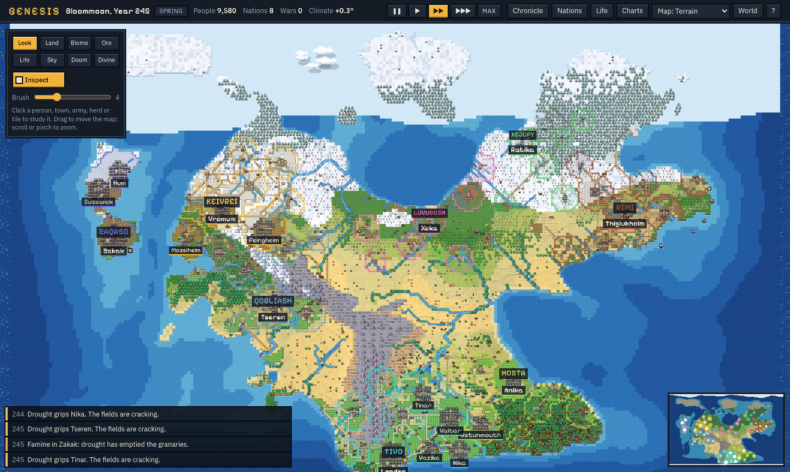
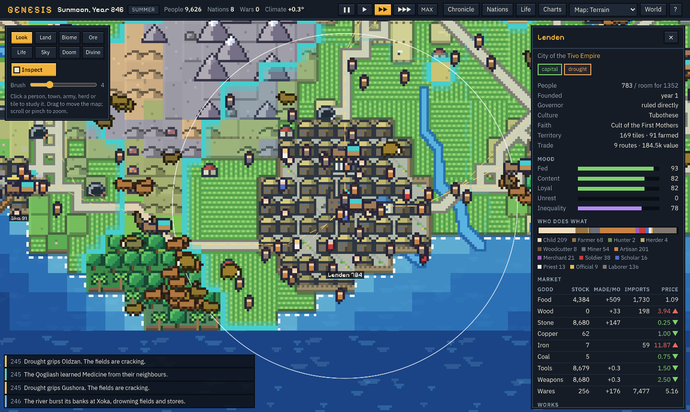

# Project Genesis

A god-simulation sandbox: a procedurally generated planet with climate, ecology, individually simulated
people, economies, states, wars, technology and a self-written history — plus the tools to reach in and
change any of it.

**Play it:** open `dist/index.html` in a browser. It is one self-contained file (no server, no install).





## Playing

| | |
|---|---|
| Move / zoom | drag, scroll or pinch · `W` `A` `S` `D` |
| Time | `Space` pause · `1`–`4` speed (4 = as fast as your machine allows) |
| Inspect | click anything: a person, town, army, caravan, herd, tile |
| Powers | left panel: Land, Biome, Ore, Life, Sky, Doom, Divine |
| Map modes | `M` cycles terrain / political / biomes / temperature / moisture / fertility / resources / cultures / faiths |
| Windows | Chronicle (searchable history), Nations, Life (species + species creator), Charts, World (new world, save/load, laws of nature) |

Zoom in close to see individual residents going to their actual workplaces; click one to read their
temperament, family, and life story. Open a nation to see who holds power, what it remembers, and to run
experiments on it (culture sliders, isolation, forced government, incited wars).

## Build and test

```sh
npm install
npm run build          # → dist/index.html (standalone) and dist/artifact.html (embeddable fragment)
npm run typecheck
npm test               # headless scenario tests of the simulation (Node)
npm run soak -- 1234 500      # watch a seed develop for 500 years in the terminal
npm run test:browser   # end-to-end test of the built game in headless Chromium (needs Playwright)
```

What the automated tests verify (all passing at the time of writing):

- **Determinism** – same seed ⇒ bit-identical state hash after 30 years; different seed ⇒ different world.
- **Save/load fidelity** – a saved world reloads to the same state hash, and the original and the loaded
  copy remain identical when both are run 25 more years.
- **Settlement founding** – tribes find work within two years, grow, clear farmland, found new settlements.
- **Resource shortage** – a multi-year drought cuts food, the simulation itself records a famine, people starve and leave.
- **Trade** – routes are discovered, merchants deliver goods; a glut lowers the local price, scarcity raises it.
- **Conflict** – a declared war raises armies of real people, produces battles/sieges, and ends with an outcome and grievances.
- **Supply** – a besieged town's food production collapses and its people go hungry.
- **God powers** – sculpting creates land, a tribe can be placed on it, a meteor destroys a town and cools the climate, granted technology changes modifiers, plague kills.
- **Ecology without people** – forests and animal populations change by themselves; predators and prey both persist.
- **Browser** – boot, pause/speed, clicking the map, every window, the tool palette (raise land, meteor),
  the technology tree, save-then-load through the real buttons, new-world form, frame rate, and a
  phone-sized viewport with no sideways scroll.

## Architecture

```
src/sim/      the simulation — pure TypeScript, no DOM, deterministic
  rng.ts        seeded PRNG + value/fractal/ridged noise
  types.ts      the whole data model (plain data: objects, typed arrays, Maps)
  worldgen.ts   plates → elevation → oceans → climate → rivers/lakes → soil → flora → geology
  world.ts      tile helpers, hydrology (priority-flood), seasonal temperature, biome classification
  climate.ts    long cycles, drift, greenhouse, dust, sea level, moving storms, lightning
  ecology.ts    soil moisture, plant growth & succession, flora adaptation, erosion, floods, fire, fish; herds
  people.ts     individuals: heritable traits, skills, jobs, marriage, births, deaths, faith, loyalty, migration
  settlement.ts land use, production, market prices, consumption, wages, taxes, construction, unrest, plague
  trade.ts      route discovery, merchants and caravans, roads
  parties.ts    groups on the move: migrants, refugees, settlers, caravans, ships
  path.ts       A* over land (terrain, roads, fords) and sea
  civ.ts        factions, laws, government change, succession, research, expansion, coups, revolutions, secession
  diplomacy.ts  relations, pacts, alliances, union, tribute, the decision to go to war
  war.ts        armies, supply, morale, battles, sieges, sack, refugees, blockade, peace terms
  culture.ts    culture values, traditions, daughter cultures and languages, prophets, schisms
  tech.ts       62 technologies with prerequisites, environmental requirements and concrete modifiers
  names.ts      procedural languages (phonology inherited and shifted by daughter cultures)
  history.ts    event log and yearly statistics
  powers.ts     god powers and natural disasters (the same code)
  save.ts       exact serialization + state hash
  sim.ts        creation and the tick
src/render/   Canvas renderer — reads simulation state, never writes it
  sprites.ts    the sprite sheet, as text
  terrain.ts    pixel-art rasterizer into cached 256×256 chunks (8 px per tile), double-buffered seasons
  renderer.ts   camera, sea, borders, overlays, herds, people, caravans, armies, weather, effects, labels
src/ui/       DOM interface: palette, inspector, windows, storage
src/main.ts   game loop, input, world lifecycle
test/         scenario tests, soak runner, browser test
```

**Time.** One tick is a quarter of a month; 48 ticks make a year. Systems run at their natural cadence and
are staggered so no tick is heavy: storms, fires, travelling groups and armies every tick; each settlement
(and everyone in it) once a month on its own phase; each state once a season; statistics and geology yearly.

**Determinism.** All randomness comes from one seeded generator stored in the state; update order is fixed;
the renderer has its own clock and randomness and cannot affect the simulation. Nothing in the simulation
depends on the camera, so a world develops identically whether or not anyone is looking.

**Scale and cost.** Tile fields are typed arrays; animals use a coarse spatial grid; pathfinding results
(trade routes) are stored and reused. On the default 256×160 world the simulation costs roughly 1 ms per
tick at 1,000 people and 3–4 ms at 6,000–9,000 (Node 22, one core), i.e. several simulated years per
second at full speed. In headless Chromium the game held 54–61 fps while simulating at normal speed, and
300–430 ticks/s at maximum speed with ~3,000 people. World size (160×100 to 448×280) and the population
limit (5k–50k) are chosen at world creation; the limit works by damping births as it is approached.

**Rendering.** The look is chunky pixel art: every tile is a flat block of palette colour chosen from
what the simulation says is there (biome, moisture, season), with stepped terraces, banded sea depths and
foam at the shore; everything standing on the land — trees, peaks, houses, walls, people, herds, ships —
is a hand-drawn outlined sprite written as text in `src/render/sprites.ts` and recoloured per culture,
season, species and nation. Terrain is rasterized by hand into pixel buffers and cached per chunk; only
chunks touched by a change are redrawn. Seasonal redraws are painted off-screen and swapped in whole so
neighbouring chunks never show different months. Everything animated (waves, walkers, particles, clouds)
is computed only for what is on screen.

## What is simulated

**Planet.** Tectonic-plate terrain with mountain belts on convergent boundaries; rivers and lakes from
depression filling and flow accumulation; temperature from latitude and altitude with seasons; rainfall from
latitude bands, moisture carried by prevailing winds and rain shadows; multi-year regional droughts and wet
spells; century-scale climate cycles and drift; greenhouse warming from coal and oil actually burned;
volcanic and impact winters; sea level that follows global temperature. Soil moisture, grass, forest
succession (spreading from neighbours), flora that slowly adapts to its local climate, soil that builds
under plants, blows away when bare and dry, and washes downhill; river floods; wildfire that spreads
through dry fuel; fish stocks. Ore deposits follow geology and run out.

**Animals.** Herds graze real vegetation, predators hunt real herds, herds breed when fed and die when not,
move toward food and tolerable temperatures. Each herd carries its own trait values; offspring herds
mutate; lineages that drift far from their species' type become new species (recorded in the chronicle),
and species go extinct.

**People.** Every person has heritable temperament (ambition, charisma, boldness, intellect, compassion,
diligence, piety, greed), skills that grow with practice, a family, friends and rivals, wealth, faith,
loyalty, a faction, a life goal, and remembered life events. They choose work by expected income, aptitude,
ambition and open positions; marry (like tends to marry like); have children when fed and housed; convert
under the influence of friends and the local majority; and leave — for a better town along known routes, or
into the wilderness to found a new one — when hunger, unhappiness, danger or crowding outweigh their roots.

**Economy.** Farmers work real tiles (yield from fertility, moisture, season; soil wears out without crop
rotation); fishers draw down real fish stocks; hunters take animals from real herds; woodcutters thin real
forest; miners deplete real deposits; artisans turn wood and metal into tools, weapons and wares. Each
settlement has its own stock and its own prices, set by stock against demand. Before currency a community
shares food; with currency people buy it, and in a shortage the poor go without first (unless the state
runs a grain dole). Wages follow the value of output; taxes fill the treasury that pays soldiers, scholars
and officials and funds buildings and roads. Merchants risk their own capital carrying physical goods
between towns where the price difference beats haulage and tariffs; busy routes get roads; plague travels
with the caravans; war and blockade stop them.

**States.** Eight forms of government, five factions weighted by wealth, office and arms; eight laws that
change how the rules apply (serfdom binds farmers, conscription widens the levy, closed borders stop trade
and migrants, intolerance breeds unrest among other faiths…). Succession depends on the constitution
(heirs, elections, the richest house, the conclave, the strongest general) and can be disputed by an
ambitious sibling. Unrest that finds a leader becomes a coup, a revolution in the capital, or a secession
— and the leader's own occupation and faction shape the state that results. Cultures have values that
drift with what their people live through, crystallise into traditions, and split into daughter cultures
with daughter languages. Faiths are founded by actual pious, charismatic individuals, named for the land
they arose in, and split in schisms.

**Diplomacy and war.** Regard between states comes from trade volume, shared culture and faith, border
friction, common enemies, and remembered grievances that fade over generations. A state goes to war when
motive (land hunger, a specific scarce good a neighbour has, old wrongs, zeal, opportunity) outweighs what
it would lose (trade, exhaustion) *and* it judges it can win and afford it; a much weaker neighbour may be
bullied into tribute instead. Armies are organisations of real people under a general: mustered from
soldiers and a levy of working adults, fed over a supply line from their own granaries, holding or losing
morale, favoured by hills, forests and rivers on defence. They intercept invaders, besiege towns (starving
them out or storming the walls), sack or spare them, and send refugees down the roads. Wars end in ceded
towns, tribute, independence, a change of regime, annexation or exhausted stalemate — and leave grievances.

**Technology.** 62 technologies in a web. Each needs its prerequisites *and* what the land offers (no
bronze without copper, no riding without a rideable animal, no sailing without a coast, no steam without
coal), so societies take different paths. Ideas diffuse along trade relationships. A society can only hold
as much knowledge as it has scholars and records to carry it: after a collapse, arts are lost — and can be
recovered faster later, or learned from the ruins of those who knew them. Every technology changes concrete
modifiers (yields, storage, health, army strength, haulage, sea range, building density, emissions).

**History.** The chronicle is written only by simulation events. Every person keeps a biography; the
notable dead keep theirs; states keep collective memories and grudges that new states born from them
inherit.

## Where the simulation is abstract

Stated plainly, so nothing is mistaken for more than it is:

- **Daily movement in towns is illustrative.** The little figures are real residents shown at their real
  workplaces, but the walking is drawn, not simulated. Life inside a settlement advances in monthly steps.
  Journeys between places (migrants, settlers, caravans, armies, herds) *are* simulated on the map.
- **Animals are herds, plants are fields.** Evolution acts on herd-level trait values, not individual genomes.
- **Money is not conserved.** Each market is the counterparty to wages and purchases; prices come from goods, not money supply.
- **No households or land ownership.** Wealth is individual; inheritance passes to spouse and children; class emerges from wealth, not from deeds to land.
- **Battles are statistical.** Armies are real groups of real people with a general, supply and morale, but a battle is resolved between two armies as wholes, not as manoeuvring units.
- **Navies are a number.** Sea transport, sea trade and blockades have real effects, but fleet strength is derived from harbours and technology rather than individual warships.
- **Soldiers on campaign do not age** until they come home (campaigns are short relative to lifetimes).
- **Federations** exist as defensive alliances and as acts of union that merge two states of one culture; there are no multi-tier federal constitutions.
- **Late eras are thin.** Industrial-to-atomic technologies change production, health, transport, emissions and the look of cities, but there are no aircraft, nuclear weapons or space.
- **File export** uses a normal browser download; embedded viewers that block downloads can still use the in-browser save slots.

## Ideas for later

Explicit households and land tenure; individual warships and naval battles; river transport; disease
strains with immunity; named laws debated by councils; espionage; individual animal agents near the camera;
a WebWorker for the simulation; larger worlds via region-level aggregation far from any settlement.
